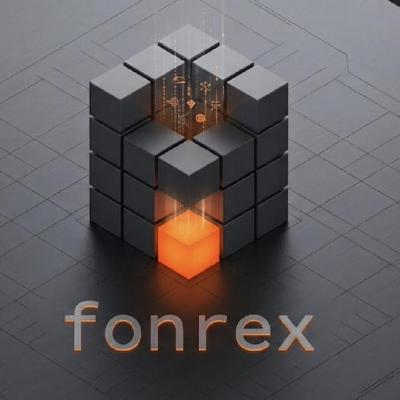
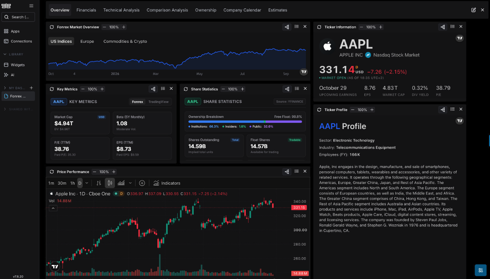

<p align="center">
  
</p>

<h1 align="center">Fonrex</h1>

<p align="center">
  <strong>Your own financial data API — self-hosted, built for European markets.</strong><br/>
  Prices, fundamentals, valuations and factor models from one Docker stack, in your own database.
</p>

<p align="center">
  <a href="https://github.com/fonrex/fonrex/actions/workflows/quality.yml"></a>
  
  
  
  
</p>

<p align="center">
  <a href="#quickstart">Quickstart</a> ·
  <a href="#what-you-get">What you get</a> ·
  <a href="#works-with-your-tools">Integrations</a> ·
  <a href="#endpoints">Endpoints</a> ·
  <a href="https://fonrex.io/docs/intro">Documentation</a>
</p>

<p align="center">
  
</p>

---

## Why Fonrex?

Good financial data on European shares is expensive, and cheap data is often wrong: a ticker
lands on the wrong company, a price is in pence instead of pounds, a ratio is a percentage on
one site and a fraction on another. Fonrex fixes this on your own machine.

- **European listings done right.** `AIR.PA` is Airbus, never AAR Corp. Prices are stored per
  listing, in its currency, dated by trading session; one ISIN can have many listings.
- **Every figure says where it comes from.** Fundamentals are cross-checked between sources;
  values that disagree with the others are rejected, and each answer names its sources.
- **Valuation and research built in.** DCF with the risk-free rate of the right currency
  (FRED for USD, ECB for EUR), Fama/French factor exposure, technical indicators.
- **Works with your tools.** OpenBB Workspace, Google Sheets, Python and Jupyter, Zipline backtests.
- **Yours.** Self-hosted, no subscription, no vendor lock-in: the data lives in your PostgreSQL.

---

## Quickstart

You need Docker with Docker Compose, and 4 GB of RAM (8 GB recommended).

```bash
git clone https://github.com/fonrex/fonrex && cd fonrex
cp .env.example .env

# An API key is required: every request is refused until one is set
export FONREX_API_KEY="frx_live_$(openssl rand -hex 24)"
sed -i.bak "s/^FONREX_API_KEY=.*/FONREX_API_KEY=$FONREX_API_KEY/" .env && rm .env.bak

mkdir -p logs
docker compose up -d                       # starts the API, PostgreSQL and Redis; runs the migrations
docker compose exec fonrex-api python import_assets.py --file data/etf.csv
```

Change `POSTGRES_PASSWORD` in `.env` before the first start as well. Then try it:

```bash
AUTH="X-API-KEY: $FONREX_API_KEY"

curl -H "$AUTH" "http://localhost:5000/fundamental?ticker=AIR.PA"          # fundamentals, with their sources
curl -H "$AUTH" "http://localhost:5000/eod/AIR.PA?period=1y"                # daily prices (fetched on first call)
curl -H "$AUTH" "http://localhost:5000/dcf/AIR.PA"                          # intrinsic value
curl -H "$AUTH" "http://localhost:5000/factors/exposure/AIR.PA?model=ff5"   # Fama/French betas
```

The interactive API documentation is on `https://fonrex.io/`. To feed the whole
documentation to an LLM, use [llms.txt](https://fonrex.io/llms.txt).

---

## What you get

| | |
|---|---|
| 📈 **Prices** | Ten years of daily history by default, per listing; traded prices adjusted for splits and an `adj_close` adjusted for dividends; weekly and monthly bars; realtime ticks over WebSocket |
| 🧾 **Fundamentals** | Statements, highlights, earnings, analyst ratings, ESG scores, ETF details and holdings, insider transactions (SEC) |
| 💶 **Valuation** | FCF, EPS and dividend DCF models, model comparison, WACC × growth sensitivity matrix, cost of equity from the CAPM or the Fama/French factors |
| 🧮 **Factors and rates** | Kenneth French factor returns (US, Europe, developed markets), factor exposure of a listing, FRED and ECB rates, US Treasury yield curves (nominal and real, daily since 1990), ECB exchange rates, Eurostat indicators by country (inflation, unemployment, GDP growth, economic sentiment) |
| 📊 **Technical analysis** | Indicators computed on your stored prices, multi-indicator reads, a screener |
| 📰 **News** | Deduplicated articles from several sources, per ticker and as a global feed |
| 🛡️ **Data quality** | Range checks, cross-source consensus, a daily canary run and alerts on every provider |

### Fundamentals (19 providers)

| Group | Providers |
|---|---|
| **Europe** | ZoneBourse, Boursorama, BourseDirect, Fortuneo, InvestirLesEchos |
| **Global** | Yahoo Finance, Google Finance, MSN, MorningStar, Investing.com |
| **US** | Barron's, WSJ, MarketWatch, Gurufocus |
| **Specialised** | JustETF (UCITS ETFs), SEC Edgar (insider transactions), OpenFIGI, index constituents, US Treasury (yield curves) |

`GET /fundamental` returns one document in the EODHD layout. Each figure is taken from Yahoo
(with the symbol verified for the listing, never the bare ticker), then from the stored
figures, then from the providers that publish the same quantity; the `Sources` section names
the source of every figure. Ratios are ratios: a 0.32 % dividend yield is `0.0032`.

### Technical Indicators (18 indicators)

```
Trend     : SMA, EMA, WMA, DEMA, TEMA, VWAP
Momentum  : RSI, MACD, Stochastic, CCI, ROC, MOM
Volatility: Bollinger Bands, ATR, Keltner Channels
Volume    : OBV, A/D Line, MFI
```

### Valuation and factors

`GET /dcf/{ticker}` values a company with the FCF model; `POST /dcf/{ticker}` chooses the
models (FCF, EPS, DDM), the horizon, the growth and the WACC inputs. Cash flows are discounted
with the risk-free rate of their currency. With `wacc_params.cost_of_equity_model` set to
`ff3`, `ff5` or `carhart`, the cost of equity comes from the betas of the listing and the
long-run premia of the Fama/French factors of its region. `GET /factors/exposure/{ticker}`
gives those betas on their own, with their t-stats and the R².

### News (7 providers)

Yahoo Finance, Google Finance, ZoneBourse, Boursorama, Investing.com, MarketWatch and MSN
Finance, deduplicated by URL and by title similarity.

---

## Works with your tools

| Tool | What you get |
|---|---|
| **[OpenBB Workspace](integrations/openbb/README.md)** | Your instance as a data source: quotes, fundamentals, DCF, technical charts, news, macro rates and factors in ready-made dashboards — 24 available widgets |
| **[Google Sheets](fonrex-sheets-connector/README.md)** | Fundamentals, DCF values and indicators in a spreadsheet, with a read-only key |
| **Python & Jupyter** | Plain REST and JSON with `httpx` or `requests` and pandas — see the [notebook guide](https://fonrex.io/docs/guides/python-jupyter) |
| **[Zipline](docs/zipline-bundle.md)** | A data bundle reading your stored prices, for backtests |

---

## Endpoints

| Area | Main routes |
|---|---|
| Prices | `GET /eod/{ticker}` · `GET /ticker/{symbol}/history` · `POST /historical/ingest` · `GET /quote/{ticker}` · `GET /quotes` · `WS /ws/realtime/{ticker}` |
| Fundamentals | `GET /fundamental` · `GET /fundamental/deep` · `GET /etf/{isin}/details` · `GET /insider-transactions/{ticker}` · `GET /index/{name}/constituents` |
| SEC filings | `GET /sec/{ticker}/statements` · `GET /sec/{ticker}/check` · `POST /sec/{ticker}/refresh` |
| Valuation | `GET /dcf/{ticker}` · `POST /dcf/{ticker}` · `GET /dcf/{ticker}/compare` · `GET /dcf/{ticker}/sensitivity` |
| Factors and rates | `GET /factors` · `GET /factors/{dataset}` · `GET /factors/exposure/{ticker}` · `GET /macro/rates` · `GET /macro/indicators` · `GET /macro/indicators/{indicator}` · `GET /macro/treasury/curve` · `GET /macro/treasury/series` |
| Technical analysis | `GET /technical/{ticker}` · `GET /technical/{ticker}/multi` · `GET /technical/{ticker}/chart` · `GET /technical/screen` |
| News | `GET /news/{ticker}` · `GET /news/feed` |
| Assets | `GET /assets/by-isin/{isin}` · `GET /listings` |
| Data quality | `GET /health/providers` · `GET /health/alerts` · `POST /health/canary/run` · `GET /health/stats` |

Every route requires an API key, sent as `X-API-KEY` or `Authorization: Bearer`. Keys listed
in `FONREX_READ_ONLY_API_KEYS` can read everything but change nothing: use one for any client
that stores the key outside your machine. The full reference, with parameters and examples,
is in the [documentation](https://fonrex.io/docs/intro).

---

## How it works

```
┌──────────────────────────────────────────────────────────────┐
│    Your tools: OpenBB · Google Sheets · Python · Zipline     │
└────────────┬──────────────────┬──────────────────────────────┘
             │ REST             │ WebSocket
┌────────────▼──────────────────▼──────────────────────────────┐
│                   FastAPI (port 5000)                        │
│  prices · fundamentals · DCF · factors · technical · news    │
│  validation layer · daily canary · realtime worker           │
└──────┬────────────────┬──────────────────┬───────────────────┘
       │                │                  │
┌──────▼──────┐  ┌──────▼───────┐  ┌───────▼───────────────┐
│   Redis 7   │  │  TimescaleDB │  │   Public sources      │
│  cache and  │  │  PostgreSQL  │  │  Yahoo / TradingView  │
│  pub/sub    │  │  your data   │  │  19 providers         │
└─────────────┘  └──────────────┘  └───────────────────────┘
```

Your instance fetches public data and keeps it in your own database. Requests to every
provider go through one HTTP layer: same retries, same concurrency limit, and an optional
outbound proxy (`FONREX_PROXY_URL`).

<details>
<summary><strong>Configuration</strong></summary>

Copy `.env.example` to `.env` and adjust it. The main settings:

| Variable | Default | What it does |
|---|---|---|
| `FONREX_API_KEY` | — | Full-access key (required) |
| `FONREX_READ_ONLY_API_KEYS` | — | Keys that can read but not change anything |
| `POSTGRES_PASSWORD` | `changeme` | Database password: change it before the first start |
| `FRED_API_KEY` | — | Live US risk-free rate (the ECB needs no key) |
| `DCF_RISK_FREE_RATE` | `0.04` | Risk-free rate when no source answers |
| `FONREX_PROXY_URL` | — | Outbound proxy for the providers |
| `USAGE_LOG_IP` | `none` | Whether the local usage log keeps caller IPs |

Every variable is described in `.env.example` and in the
[configuration guide](https://fonrex.io/docs/getting-started/configuration).

</details>

<details>
<summary><strong>Updating, backups and troubleshooting</strong></summary>

```bash
# After git pull: rebuild the image (migrations run at start)
docker compose up -d --build

# Development: run the code of this folder without rebuilding
docker compose -f docker-compose.yml -f docker-compose.dev.yml up

# Backup
docker compose exec -T db pg_dump -U fonrex -d fonrex -Fc > fonrex.dump
```

- **`401` or `403` on every request**: set `FONREX_API_KEY` in `.env`, restart with
  `docker compose up -d`, and send the key with each request.
- **No price, or the wrong listing**: catalogue tickers are not Yahoo symbols. Fonrex looks the
  symbol up from the ISIN and the currency of the listing, and ingests nothing rather than the
  price of another instrument; the answer says why. Name the listing with `currency`,
  `exchange` or `isin`, and replace a series with
  `POST /historical/ingest?ticker=<ticker>&force_refresh=true`.
- **Permission denied on `logs`**: `mkdir -p logs && chmod 777 logs`.
- **Container name already in use**: `docker rm -f fonrex-db fonrex-redis fonrex-api`.

Restoring a backup, upgrading an older installation and cleaning old prices are covered in the
[deployment guides](https://fonrex.io/docs/deployment/docker).

</details>

<details>
<summary><strong>Tests and quality checks</strong></summary>

```bash
make install-dev   # exact versions of the lock files
make ci            # lint, typing, migrations, tests, coverage — what GitHub Actions runs
make test-db       # database tests on a throwaway TimescaleDB container (needs Docker)
```

No test reaches the network: providers are tested against reduced copies of real pages. Guard
tests keep the documents honest, from the counts quoted in this README to the settings of
`.env.example`.

</details>

---

## Roadmap

- [x] Provider health monitoring (validation layer + daily canary)
- [x] Zipline bundle for backtests
- [x] Fama/French factors and factor-based cost of equity
- [ ] Sentiment analysis on news articles
- [ ] Portfolio tracking endpoints
- [ ] DCF bulk valuation endpoint
- [ ] Webhooks for price alerts

---

## Scope: self-hosted, and what Fonrex Relay will be

Fonrex is software you run yourself. Your instance fetches the data from public sources and
keeps it in your own database: there is no Fonrex-operated data API, and the integrations
above (OpenBB Workspace, Google Sheets) connect to **your** instance.

**Fonrex Relay** is a separate, optional paid service, still in development. It will be an
outbound relay that your instance can route its provider requests through. It relays pages;
it does not store or serve financial data. Fonrex does not depend on it.

---

## Contributing

Contributions are welcome: read [CONTRIBUTING.md](CONTRIBUTING.md) first. The rules of the
code base, and the tests that enforce them, are in [AGENTS.md](AGENTS.md); they apply to human
contributors and to AI coding agents alike. Adding a provider follows the checklist of
[AGENTS.md](AGENTS.md).

```bash
python -m venv venv && source venv/bin/activate
make install-dev
make ci
```

---

## License and responsible use

AGPL-3.0 — see [LICENSE](LICENSE). Fonrex reads public web pages on your behalf: you are
responsible for respecting the terms of use of each source. Read the [DISCLAIMER](DISCLAIMER.md).

<p align="center">
  Built for people who want to own their financial data stack.<br/>
  <a href="https://fonrex.io/docs/intro">Documentation</a> · <a href="https://github.com/fonrex/fonrex/issues">Issues</a>
</p>
