# Data Model and Identity Resolution

This document details the relational and TimescaleDB schema (`models.py`) and the rules that resolve a ticker or an ISIN to an instrument and listing. For the high-level system map, routes and migrations, see [ARCHITECTURE.md](../ARCHITECTURE.md).

## Data Model

The identity of an instrument is separated into three levels:

- `assets` represents the canonical financial instrument. An ISIN should ideally identify a single instrument.
- `asset_listings` represents a listing of an instrument: ticker, exchange, currency, source, primary/active status.
- `asset_mappings` represents the provider-specific identifiers for an instrument or a listing.

This separation is necessary because:

- The same ISIN can be listed under multiple tickers, exchanges, or currencies.
- The same ticker can designate different instruments depending on the market, for example a stock and an ETF.
- Not all providers accept the same identifier: some want a Yahoo ticker, others an ISIN, others a URL or an internal code.

```mermaid
erDiagram
    ASSETS ||--o{ ASSET_LISTINGS : "has listings"
    ASSETS ||--o{ ASSET_MAPPINGS : "has global mappings"
    ASSET_LISTINGS |o--o{ ASSET_MAPPINGS : "has provider mappings"
    ASSET_LISTINGS ||--o{ PRICES_EOD : "has a price series"
    ASSETS ||--o{ PRICES_EOD : "instrument of the series"
    ASSETS ||--o{ FUNDAMENTALS : "has fundamentals (legacy)"
    ASSETS ||--o| FUNDAMENTALS_HIGHLIGHTS : "has highlights"
    ASSETS ||--o{ FINANCIAL_STATEMENTS : "has financial statements"
    ASSETS ||--o{ EARNINGS_HISTORY : "has EPS history"
    ASSETS ||--o| ANALYST_RATINGS : "has ratings"
    ASSETS ||--o| ETF_DETAILS : "has ETF details"
    ASSETS ||--o{ ETF_HOLDINGS : "has ETF holdings"
    ASSETS ||--o| ESG_SCORES : "has ESG scores"
    ASSETS ||--o{ EARNINGS_TREND : "has estimates"
    ASSETS ||--o{ OUTSTANDING_SHARES_HISTORY : "has capital history"
    ASSETS ||--o{ INGEST_LOG : "has ingestion logs"
    ASSETS ||--o{ PRICES_INTRADAY : "has intraday prices"
    ASSETS ||--o| REALTIME_SUBSCRIPTIONS : "has a realtime subscription"
    ASSETS |o--o{ NEWS_ARTICLES : "has news"

    MACRO_RATES_CACHE {
        int id PK
        string series_id
        string label
        numeric value
        string unit
        date observation_date
        timestamp fetched_at
    }

    USAGE_LOGS {
        int id PK
        string api_key_id "fingerprint of the key, never the key"
        string endpoint
        string method
        int status_code
        int latency_ms
        string provider_used
        bool cache_hit
        string cost_bucket
        string ip_address
        text user_agent
        timestamp created_at
    }

    PROVIDER_HEALTH_LOG {
        int id PK
        timestamp checked_at PK
        string provider_name
        string ticker
        string field
        numeric value_received
        numeric value_expected_min
        numeric value_expected_max
        numeric consensus_value
        numeric deviation_pct
        string status
        string check_type
    }

    PROVIDER_HEALTH_DAILY {
        int id PK
        string provider_name
        date date
        int checks_total
        int checks_ok
        int checks_outlier
        int checks_null
        int checks_timeout
        numeric success_rate
        int avg_latency_ms
        bool canary_passed
        bool is_healthy
    }

    PROVIDER_ALERTS {
        int id PK
        string provider_name
        string alert_type
        string severity
        text description
        string ticker
        string field
        numeric value_received
        string value_expected
        timestamp created_at
        timestamp resolved_at
        bool is_resolved
        text resolution_note
    }

    ASSETS {
        int id PK
        string ticker
        string isin
        string name
        string display_name
        string official_symbol
        string exchange
        string currency
        string quote_type
        string sector
        string industry
        string logo_path
    }

    ASSET_LISTINGS {
        int id PK
        int asset_id FK
        string ticker
        string exchange
        string currency
        string source
        bool is_primary
        bool is_active
    }

    ASSET_MAPPINGS {
        int id PK
        int asset_id FK
        int asset_listing_id FK
        string provider_name
        string provider_ticker
        string provider_url
        string source
        float confidence_score
        bool is_active
        int failure_count
        timestamp last_verified_at
    }

    PRICES_EOD {
        int asset_listing_id PK, FK
        string resolution PK
        timestamp time PK
        int asset_id FK
        float open
        float high
        float low
        float close
        float adj_close
        bigint volume
        bool adjusted
        string source
    }

    PRICES_INTRADAY {
        timestamp timestamp PK
        int asset_id PK, FK
        float open
        float high
        float low
        float close
        bigint volume
        string resolution
        string source
    }

    REALTIME_SUBSCRIPTIONS {
        int id PK
        int asset_id FK "unique"
        string ticker
        string tv_exchange
        string tv_symbol
        bool is_active
        timestamp subscribed_at
        timestamp last_tick_at
        bigint tick_count
    }

    FUNDAMENTALS {
        timestamp timestamp PK
        int asset_id FK
        numeric market_cap
        numeric pe_ratio
        numeric dividend_yield
        json extra_metrics
    }

    FUNDAMENTALS_HIGHLIGHTS {
        int id PK
        int asset_id FK
        timestamp fetched_at
        string source
        numeric market_cap
        numeric enterprise_value
        numeric pe_ratio
        numeric roe
        numeric roa
        numeric dividend_yield
        numeric beta
        bigint shares_outstanding
        numeric debt_to_equity_ratio
        numeric debt_to_assets_ratio
        numeric net_debt_to_ebitda
        numeric interest_coverage_ratio
        numeric actual_cost_of_debt
        string cost_of_debt_source
    }

    FINANCIAL_STATEMENTS {
        int id PK
        int asset_id FK
        string statement_type
        string period_type
        date period_end
        numeric revenue
        numeric ebitda
        numeric net_income
        numeric total_assets
        numeric total_equity
        numeric total_debt
        numeric operating_cashflow
        numeric free_cashflow
    }

    EARNINGS_HISTORY {
        int id PK
        int asset_id FK
        string period
        date period_end
        numeric eps_actual
        numeric eps_estimate
        numeric surprise_pct
    }

    ANALYST_RATINGS {
        int id PK
        int asset_id FK
        string consensus
        numeric target_mean
        numeric target_low
        numeric target_high
        int nb_analysts
        int strong_buy
        int buy
        int hold
        int sell
        int strong_sell
    }

    ETF_DETAILS {
        int id PK
        int asset_id FK
        date inception_date
        numeric net_expense_ratio
        numeric total_net_assets
        string replication_method
        numeric return_1y
        numeric return_3y
        numeric return_5y
    }

    ETF_HOLDINGS {
        int id PK
        int etf_asset_id FK
        string holding_ticker
        string holding_name
        numeric weight
        string sector
        string country
    }

    ESG_SCORES {
        int id PK
        int asset_id FK
        numeric total_esg
        numeric environment_score
        numeric social_score
        numeric governance_score
        int controversy_level
    }

    EARNINGS_TREND {
        int id PK
        int asset_id FK
        string period
        numeric revenue_avg
        numeric revenue_growth
        numeric eps_avg
        numeric eps_growth
    }

    OUTSTANDING_SHARES_HISTORY {
        int id PK
        int asset_id FK
        date date
        bigint shares
        string period_type
    }

    INGEST_LOG {
        int id PK
        int asset_id FK
        string ticker
        string resolution
        string source
        string status
        int records_added
        date from_date
        date to_date
        string error_msg
        int duration_ms
        timestamp created_at
    }

    NEWS_ARTICLES {
        int id PK
        int asset_id FK
        string title
        text summary
        string url UK
        string image_url
        string source
        string provider
        string author
        timestamp published_at
        timestamp fetched_at
        string sentiment
        numeric sentiment_score
        array related_tickers
        array related_isin
        string language
    }
```

Constraints, indexes, and compatibility:

- The diagram shows the columns that matter to understand the model, not every column: `models.py` is the reference.
- `AssetListing` is unique by `(asset_id, ticker, exchange, currency)` — constraint `uq_asset_listing_identity`, created with the table and re-asserted by migration 009.
- An instrument has at most one primary listing: the partial unique index `uq_asset_listings_one_primary` on `asset_listings (asset_id) WHERE is_primary` (migration 029, which first kept the oldest of the primary listings that older imports had left).
- `AssetMapping` is unique by `(asset_listing_id, provider_name)` (constraint `uq_asset_listing_provider`). `asset_listing_id` may be empty: the mapping then applies to every listing of the instrument, and PostgreSQL does not treat two such rows as duplicates. `source` says where the identifier comes from (`csv_import`, `manual`, `isin_search`, `ticker_check`, `symbol_not_found`) and `last_verified_at` when it was last confirmed: see [Source Symbol](historical-and-import.md#3-source-symbol-historicalyahoo_symbolspy).
- `RealtimeSubscription` has a unique constraint `uq_realtime_sub_asset` on `asset_id`.
- `assets.isin` is protected by the unique partial index `uq_assets_isin_not_null` (`WHERE isin IS NOT NULL`), created by migrations 001 and 004. Migration 009 merges the duplicates left in older databases and creates the index where it was still missing. A single `Asset` per ISIN is guaranteed at the database level.
- The old columns `assets.ticker`, `assets.exchange`, and `assets.currency` remain for legacy compatibility, but reliable identity goes through `asset_listings`.
- `prices_eod` holds one row per **listing, resolution and trading session**: its primary key is `(asset_listing_id, resolution, time)`. Prices belong to a listing (a ticker on an exchange, in a currency), not to the instrument: the EUR and USD listings of one ETF are two series, and a weekly bar never replaces a daily one. `time` is the date of the session on its exchange, stored as midnight UTC of that date (8 January in Paris and in New York are both `2024-01-08 00:00+00`). `asset_id` is kept on the row for instrument-wide statistics, with the index `ix_prices_eod_asset_resolution_time` on `(asset_id, resolution, time)`.
- `prices_eod` is a **TimescaleDB hypertable** on `time`, compressed by `(asset_listing_id, resolution)` with a policy that compresses the chunks older than 14 days (migration 014).
- `prices_weekly` and `prices_monthly` are TimescaleDB continuous aggregates of the daily bars, per listing, refreshed once a day. `QueryService.get_history()` reads them only when no `1W` or `1M` row is stored for the listing.
- `prices_intraday` is a **TimescaleDB hypertable** partitioned daily (`chunk_time_interval => INTERVAL '1 day'`) and has a composite index `ix_prices_intraday_asset_ts` on `(asset_id, timestamp)`. An automatic retention policy purges candles older than 30 days.
- `ingest_log` has indexes on `asset_id` and `created_at` to efficiently track ingestion activity.
- `fundamentals_highlights` holds the last snapshot of an instrument (valuation, profitability, dividend, short interest, solvency), written by `YFinanceEnricher` (`financials/enrichment/yfinance_enricher.py`) and read by `DatabaseService.get_deep_fundamentals()`; `fetched_at` dates it. The enricher updates the row of the instrument or creates it: there is one row per instrument by convention, no constraint enforces it. `dividend_yield` is a ratio (`0.0032` for 0.32 %); migration 015 converted the percentages stored before.
- `fundamentals` is the legacy table of the first schema: nothing writes it any more, and its only reader (`DatabaseService.get_fundamental_data()`, as a fallback for an instrument without highlights) is not called by any route.
- `financial_statements` holds **one row per statement type**, fiscal period and frequency: the income statement, the balance sheet and the cash-flow statement of a fiscal year are three rows, each filling only its own columns. A calculation never reads "the latest row": it goes through `financials/fiscal_years.py`, which puts the rows of a year together (the debt of the balance sheet next to the interest of the income statement).
- `esg_scores` additionally contains 15 boolean columns naming the controversial activities of the company (tobacco, coal, gambling, etc.), from Yahoo Finance.
- `etf_details` and `etf_holdings` are read by `get_deep_fundamentals()` for an ETF, but nothing in the application writes them: they stay empty unless they are filled by hand. `/etf/{isin}/details` answers from JustETF and Redis, without these tables.
- `earnings_history` holds one row per quarter of an instrument (`period`, the calendar quarter of `period_end`: `2025Q3` for 2025-09-30), with the reported and estimated EPS, their difference (`surprise`) and the surprise as a ratio (`surprise_pct`: `0.1273` for 12.73 %, as Yahoo gives it). yfinance gives the quarter end dates as the index of its table; rows without a date are not stored, and the enricher logs a warning when none could be.
- `earnings_trend` stores consensus estimates over four time horizons: `0q`, `+1q`, `0y`, `+1y`.
- `news_articles` is unique on the `url` column (a unique constraint without a chosen name: PostgreSQL calls it `news_articles_url_key`), allowing the idempotent upsert `ON CONFLICT (url) DO UPDATE`. Three additional indexes cover `(asset_id, published_at)`, `published_at` (global feed), and `provider` (stats by source). Migration 010 asks TimescaleDB for a 90-day retention policy, which only applies to a hypertable: `news_articles` is a standard table, so **nothing purges old articles today**.
- `provider_health_log` is a **TimescaleDB hypertable** with automatic 30-day retention. Composite primary key `(id, checked_at)` imposed by TimescaleDB (the partitioning column must be in the PK). Index `(provider_name, checked_at)` and `(status)`. Each row represents a value check; `check_type` is `canary`, `realtime` or `consensus`.
- `provider_health_daily` contains a daily aggregate per provider, with unique constraint `uq_provider_health_daily(provider_name, date)`. Columns: counters by status, success rate, average latency, canary result, and `is_healthy` flag.
- `provider_alerts` stores alerts with index `(provider_name, is_resolved)` and `(severity, is_resolved)`. Two alert types are raised today, `canary_failed` and `high_outlier_rate`; `consecutive_nulls` and `latency_spike` are named in the schema but no code raises them. Canary alerts are auto-resolved when all checks pass.
- `macro_rates_cache` keeps the series read from FRED, unique by `(series_id, observation_date)`.
- `macro_observations` keeps the monthly and quarterly indicators of Eurostat, one row per `(source, indicator, geo, period)`; a period is dated by its first day (`2026-Q2` is `2026-04-01`) and a revision of the source replaces the value of its period. `status` keeps the flag of the source (`e` for an estimate). `macro_series_loads` records the last refresh of each series.
- `xbrl_facts` keeps the facts of the XBRL filings of the SEC, one row per `(cik, taxonomy, concept, unit, period_end, duration_days)`: a period is its end and its length in days (0 for a balance at a date). Only the value of the latest filing is kept (`accession`, `form`, `filed` name it), so that a restatement replaces the first figure. They are kept apart from `financial_statements` (Yahoo) to compare the two sources. `sec_company_loads` records the last reading of each company.
- `yield_curve_points` keeps the daily yield curves of the US Treasury (par curve since 1990, real curve since 2003), one row per `(source, curve, rate_date, tenor)`: the rate is a ratio (a real yield may be negative), `tenor` a code (`1M`, `6W`, `10Y`) and `tenor_months` its length, to sort a curve. A maturity not published on a day has no row; a file read again replaces the rates of its days. The index `ix_yield_curve_points_tenor` `(source, curve, tenor, rate_date)` serves the history of one maturity. `yield_curve_loads` records the last reading of each year of a curve.
- `cot_weeks` keeps the lines of the Commitments of Traders reports of the CFTC (`legacy` since 1986, `tff` and `disaggregated` since June 2006), one row per `(report, market_code, report_date)`: the market is its CFTC contract market code (`13874A`, `20974+`, `001602`), which stays when the name changes; `market_name` is the name of that week, with `contract_units` and `open_interest`. `cot_positions` holds the positions of each type of trader of a line, in contracts (`long`, `short`, and `spreading` for the types that have it; a non-reportable position may be negative in the Legacy history); its rows go with their line (`ON DELETE CASCADE`), so a file read again replaces its years. The index `ix_cot_weeks_report_date` `(report, report_date)` serves the latest report date and the markets of a date. `cot_loads` records the last reading of each year of a report and the file that held it (`deacot1986_2016.zip` for every year of the Legacy history).
- `esef_filings` keeps the ESEF filings of the index of filings.xbrl.org, one row per `fxo_id` (`529900S21EQ1BO4ESM68-2025-12-31-ESEF-FR-0`): the LEI of the company, the period the index gives the filing (`listed_period_end`, which can be wrong), its country, the links of its xBRL-JSON, viewer, report and package, its counts of errors, warnings and inconsistencies, and what its last reading found: `read_status` (`read`, `refused` with `read_reason`, or `missing` when there is no xBRL-JSON; checked by `ck_esef_filings_read_status`), `report_end` (the last day of the latest period of its facts: the true period of the filing) and its counts of facts, breakdowns left out and conflicts dropped. `esef_facts` holds one value per `(lei, taxonomy, concept, unit, period_end, duration_days)`: `taxonomy` is the prefix of the concept in the filing (`ifrs-full`, or an extension of the company such as `tot`), a period is its last day and its length in days (0 for a balance), and the value is the one of the latest filing (`report_end`): a restatement replaces the earlier value, an older filing read again does not. `fxo_id` names the filing of a value, and the values go with their filing (`ON DELETE CASCADE`). The indexes `ix_esef_filings_lei` `(lei, report_end)` and `ix_esef_facts_fxo_id` serve the filings of a company and the values of a filing. `esef_entity_loads` records the last reading of the filings of each company.
- `usage_logs` holds one row per API request, with indexes on `created_at` alone and combined with `endpoint`, `api_key_id` and `provider_used` (see [Cache And Logging](../ARCHITECTURE.md#cache-and-logging)).
- Two objects exist in the database without an ORM model: the `index_constituents` table (migration 003), which no code reads or writes — index constituents are fetched and kept in Redis — and the `fundamentals_v2` view (migration 002).

## Identity Resolution

`DatabaseService.get_asset_context()` is the central point for resolving an asset. It returns:

- `asset`: the ORM instrument.
- `listing`: the selected listing.
- `details`: the API profile ready to be exposed.
- `mappings`: the applicable active provider mappings, as a dictionary keyed by the provider name in lower case. A mapping attached to the selected listing replaces the instrument-wide mapping of the same provider.

Main rules:

- An ISIN search favors the corresponding instrument, then chooses a preferred listing.
- A ticker-only search is ambiguous: the active listings bearing the ticker are ranked, in this order: a stock before an ETF or a fund, a listing in USD before the others, a listing whose `source` is `import_assets` before the others (the value written by the legacy row-by-row import; the current importer writes `csv_import`, so this criterion no longer separates the listings of a catalogue), the primary listing before the secondary ones.
- The `exchange` and `currency` parameters explicitly narrow the search to a specific listing.
- When no listing matches, the instrument is searched by its own (legacy) ticker or official symbol, then by the ticker without its suffix (`AIR.PA` then `AIR`) — on the place the suffix names only (see below).
- Missing profile fields can be completed, but existing values are not overwritten.
- Enrichment checks ISIN and `quote_type` compatibility to avoid injecting stock metadata into a homonymous ETF.

This logic notably fixes cases where `TSLA` could refer to Tesla Inc. or an ETP/ETF bearing the same ticker.

**A suffix names a place** (`database/ticker_suffix.py`). The bare symbol is not an identity: `AIR` is Airbus in Paris and AAR Corp in New York. A lookup without the suffix therefore takes a listing only on the place the Yahoo suffix names: its exchange is one of the codes of that place (`.PA`: `XPAR`, `EPA`, `PAR`, `PA`…), or its exchange is empty or unknown and it is quoted in a currency of that place (EUR for `.PA`, GBP or GBX for `.L`). A listing on another known exchange or in another currency is never taken: `AIR.PA` without an Airbus listing answers `404` instead of AAR Corp. A suffix that names no exchange (`BRK.B` is a share class) gives no lookup without it. The rule is shared by the identity lookup above, the price series below, the valuation (`DCFService`) and the news (`NewsService`).

Prices follow a second, simpler rule, written once in `database/price_series.py` (`resolve_price_series` and its asynchronous twin): every API path that reads or writes `prices_eod` uses it, so a ticker cannot designate one listing when prices are written and another when they are read. For the requested ticker, then for the ticker without its suffix on the place that suffix names, it takes the listing bearing that ticker — the primary one first, then by currency and exchange in alphabetical order — and otherwise the preferred listing of the instrument whose own ticker it is. `currency` and `exchange` narrow the choice, and `isin` keeps the listings of one instrument only — a bare ticker may belong to several instruments (`NEM` is Newmont and Nemetschek), which the currency alone does not always tell apart; with `isin`, the fallback to the ticker without its suffix also stays within that instrument. `GET /eod` and `GET /ticker/{symbol}/history` return the `listing` they read (`ticker`, `isin`, `currency`, `exchange`). An instrument without any listing has no price series.

The two rules can therefore choose different listings for the same bare ticker: `/fundamental` prefers the USD listing, the price routes the primary listing. Passing `currency` or `exchange` removes the ambiguity between the listings of one instrument in both; `isin` (price routes) or an ISIN search (`/fundamental`) removes it between instruments.
