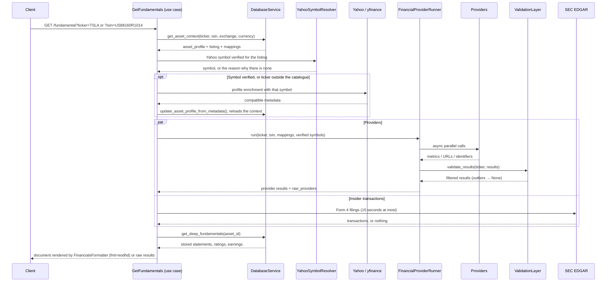
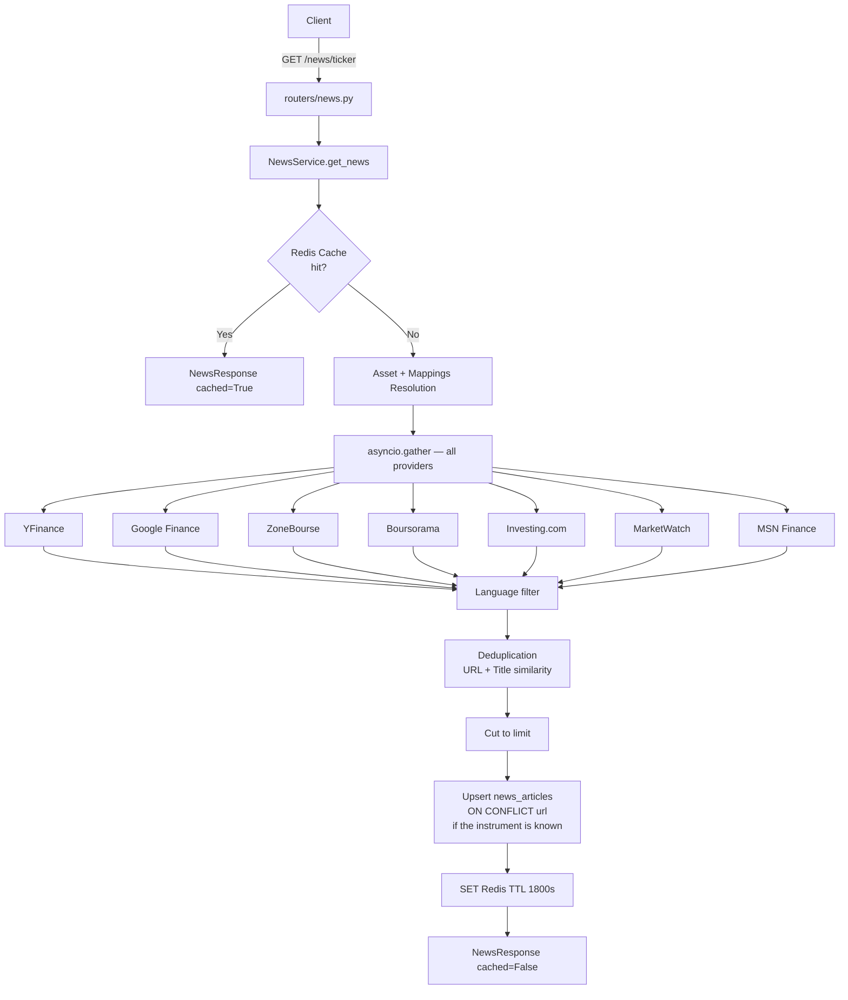

# Fundamentals Endpoints, Web Providers and Financial News

This document describes the `/fundamental`, `/fundamental/deep` and specialized endpoints, the parallel provider runner and scrapers (`financials/providers/`), and the multi-source news aggregation pipeline (`news/news_service.py`). See [ARCHITECTURE.md](../ARCHITECTURE.md) for the routes table and module map.

## Fundamentals and Specialized Endpoints

### `/fundamental` Endpoint

`GET /fundamental` accepts `ticker`, `isin`, `exchange`, `currency`, `provider` (one name, or several separated by commas, instead of all), `fmt` (`eodhd`, the default rendered document, or `raw`, the answers of the providers) and `nocache`. The complete answer is cached for one hour under `fundamental:{ticker}:{exchange}:{currency}:{fmt}:{providers}` — `providers` is `all` or the sorted list asked for, so the answer of one provider is never served to a request for all of them.

Simplified flow:

The `FinancialProviderRunner` accepts an optional `validation_layer` parameter. When provided, the results of all providers are passed to `ValidationLayer.validate_results()` **after** the `asyncio.gather` and **before** returning to the caller. Invalidated values (out of range or consensus outliers) are reset to `None`, forcing the formatter to use the values of other providers.

The `FinancialProviderRunner` chooses the search term per provider in this order:

0. For Yahoo, the symbol verified for the listing (`historical/yahoo_symbols.py`): nothing derived from the ticker or the exchange replaces it. A listing of the catalogue without a verified symbol is **not** sent to Yahoo — its bare ticker may be another instrument (`SPFF` is a US fund on Yahoo) — and the Yahoo entry of the answer says why. The profile enrichment and `/fundamental/deep` follow the same rule. A ticker that is not in the catalogue is asked as typed.
1. For GoogleFinance and Gurufocus, the ticker built from the exchange of the profile (`EPA:AIR`, `AIR.PA`) when that exchange is known: it replaces a mapping. The same rule exists for Yahoo and only applies to a request that reaches it without a verified symbol.
2. Active `provider_url` mapping.
3. Active `provider_ticker` mapping.
4. The ISIN, for ZoneBourse, Investing, wallStreetJournal, Marketwatch, Fortuneo, BourseDirect, GoogleFinance, Boursorama, Gurufocus, InvestirLesEchos and MorningStar, when none of the above applied.
   A provider whose `get_financials` takes an `isin` argument (Investing, ZoneBourse) then receives the ticker as well — its default ticker, otherwise the requested one — with the ISIN (`get_financials("AIR.PA", isin="NL0000235190")`): it searches the ISIN and chooses the listing of the place named by the ticker suffix, instead of losing that suffix.
5. Specific provider default, for example the resolved ticker for MSN during an ISIN search.
6. Requested ticker.

The term that was used is reported per provider in `raw_providers`.

Providers are called in parallel with a timeout. An error or timeout on one provider does not block the other results. A scraped provider that answers with an ISIN other than the one of the instrument (a site searched by ticker may return a homonym) is reported as an error instead of being returned under the instrument's ISIN. The SEC lookup of insider transactions runs at the same time and never holds the answer more than 15 seconds. It is made for a share whose ISIN is American or whose listing is quoted in USD (Accenture has an Irish ISIN and files with the SEC), never for a fund, and for a ticker that is not in the catalogue only when it has no exchange suffix or the suffix `.US` or `.NAS`.

**Rendered document (`fmt=eodhd`, `financials/formatter.py`).** Each figure of `Highlights`, `Valuation`, `SharesStats`, `Technicals`, `SplitsDividends` and `AnalystRatings` is chosen in this order, and the choice is reported in the `Sources` section (`{"Highlights": {"PERatio": "YahooFinance", "PEGRatio": "database (2026-10-01)"}}`):

1. the Yahoo payload fetched for this request;
2. the figures stored in the database by the deep enrichment — an earlier Yahoo answer, reported as `database (date of the fetch)`; they answer when Yahoo is not asked (listing without a verified symbol) or lacks the figure;
3. for the trailing P/E, the earnings per share and the dividend yield, the scraped providers that publish the same quantity (GoogleFinance, Barrons, Marketwatch, wallStreetJournal, Investing); in `AnalystRatings`, the consensus label (`Rating`), the number of analysts (`AnalystCount`) and the `Sentiment` label displayed by Barrons and Marketwatch.

`General` takes the ISIN, the country and the CIK left empty by the instrument and Yahoo from the providers that answered without error — SECEdgar first, then the providers listed above, then the other providers called — and gives `IPODate` as a UTC date (`1980-12-12`). `Competitors` numbers the competitors listed by the scraped providers (Marketwatch). News articles are not part of this document: they are served by the `/news` routes.

Boursorama and ZoneBourse publish estimates for the current fiscal year, GoogleFinance publishes revenue and margins of the last quarter: these are other quantities and are never used as a fallback; they remain available with `fmt=raw`. The document holds ratios: a percentage published by a source (Yahoo `dividendYield`, the fields declared in `monitoring/units.py`) is converted. Zero is a value; only a missing figure (or NaN, infinity, a text where a number is expected) falls back to the next source.

**Numbers displayed on pages** are read by `financials/numbers.py` (`parse_number` for a cell, `find_number` for a sentence): sign (including the typographic minus and accounting parentheses), thousands separators (any kind of space, comma or dot according to the page), scales (`k`, `M`, `Md`, `B`, `T`), currencies. A text that is more than a number is not half read.

### `/fundamental/deep` Endpoint

`GET /fundamental/deep` (`ticker` or `isin`, `refresh`, `sections`) returns structured data read by `DatabaseService.get_deep_sections()`: the last highlights (`FundamentalsHighlights`), quarterly/annual financial statements (`FinancialStatement`), actual vs estimated EPS history (`EarningsHistory`), and consensus analyst ratings (`AnalystRatings`). `sections` is `all` or a list among `highlights`, `statements`, `earnings`, `ratings`. The answer is kept 24 hours in Redis under `deep:{asset_id}` (an instrument, not a ticker: `AIR` is AAR Corp and the catalogue ticker of Airbus), always with every section: a request receives the sections it asked for, whatever the request that filled the entry. `refresh=true` ignores the cached answer and fetches again. The figures are fetched from Yahoo with the symbol verified for the listing (`meta.symbol`); without one nothing is fetched and `meta.note` gives the reason — the answer is then what the database already held (`meta.source` is `database`) and is not cached. The enrichment it runs includes the profile step of `YFinanceEnricher`: a request that fetches from Yahoo also fills the blank profile fields of the instrument (sector, industry, summary, website…; existing values are kept), and the blank exchange and currency of the listing of the answer (`listing_id` of its profile), the one the symbol was resolved for. A ticker outside the catalogue, asked as typed, is verified for no listing: no listing id is passed and only a listing whose ticker is Yahoo's symbol can be filled. Metadata of another instrument (ISIN or quote type) is refused and reported as skipped in the log of the enrichment. `dividend_yield` is stored as a ratio.

### Specialized Endpoints

- **`GET /insider-transactions/{ticker}`**: queries `SECEdgar` for insider transaction declarations (Form 4). Result cached for 12 hours. The filings are listed by `data.sec.gov/submissions/CIK….json`; each Form 4 is read from its XML data file, named by `primaryDocument` without its `xsl…/` folder (that folder holds the version rendered for reading).
- **`GET /etf/{isin}/details`**: queries `JustETF` for ETF metadata (fees, AUM, replication method, 1/3/5 year performance, top holdings). An ISIN known as something other than an ETF is refused. The answer is cached 24 hours in Redis; it is **not** written to the `etf_details` and `etf_holdings` tables, which no code fills today.
- **`GET /index/{index_name}/constituents`**: queries `IndexConstituents` for S&P500, CAC40, NASDAQ100, or DAX components. The result is cached 7 days in Redis.
- **`GET /quote/{ticker}`**: returns a `QuoteSnapshot` from the Redis cache (`quote:ticker`). If missing, returns the delayed Yahoo price of the ticker **as typed** (`source: yfinance`, `is_realtime: false`); this fallback does not go through the verified symbol of the listing. A `GET` changes nothing by default: the realtime subscription is started in the background only with `subscribe_if_missing=true` and a full-access key; a read-only key never starts it. `GET /openbb/quote/{ticker}` (the OpenBB quote widget) never starts it, whatever the key: its ticker is streamed once subscribed with `POST /realtime/subscribe`.
- **`GET /quotes`**: batch version of the above for a list of tickers separated by commas, cut to the first 20. It never starts a subscription.

## Fundamental Providers

Fundamental providers are declared in `main.py` in two tuples, imported when the module is loaded, and executed by `FinancialProviderRunner`: all the providers asked for a request run in parallel, each with a 12-second limit.

**Queried by `/fundamental`** (`PROVIDER_SPECS`): ZoneBourse, GoogleFinance, Boursorama, Barrons, wallStreetJournal, Marketwatch, MorningStar, Investing, Gurufocus, Fortuneo, BourseDirect, Msn, InvestirLesEchos, YahooFinance. The `provider` parameter restricts a request to some of them.

Investing reads the equity page of its search result (`/search/service/SearchInnerPage`, searching by ISIN first when given and taking among its listings the one of the place named by the ticker suffix, then by bare ticker matched against the symbol, country flag and exchange of the quote — a bare ticker prefers a United States listing and a symbol that is not found gives nothing —, with `api.investing.com/api/search/v2/search` as a fallback; a `provider_url` skips the search, and only an equity page (`/equities/…`) of `www.investing.com` or `fr.investing.com` is ever read, whether it comes from a mapping or from a search answer; an ISIN shown by the page that differs from the one asked gives nothing, and `INVESTING_USER_AGENT` overrides the default `User-Agent` of the fixed session headers shared with `InvestingComNewsProvider`), in English (`www.investing.com`) or in French (`fr.investing.com`, the decimal comma decided by `<html lang>`): the name (without the symbol in parentheses), the last price, its change and its currency, the key figures written as `<dt>`/`<dd>` pairs (the `<dd>` being the next element, whatever text or comment separates them): ISIN, PE, EPS, dividend per share and yield, market capitalisation, shares outstanding, revenue, net income, EBITDA, EV/EBITDA, book value per share, P/B, ROA, ROE, gross margin, beta, previous close, volumes and the 52-week range, and the industry, sector and staff of the company profile. Its ROA, ROE, gross margin and dividend yield are displayed percentages.

MorningStar reads two JSON services of Morningstar, never the quote page of global.morningstar.com: that page is filled in the browser by JavaScript components and answers a script with an AWS WAF challenge (HTTP 202). The screener of `lt.morningstar.com` (50 rows a page: funds come first for a short ticker) turns an ISIN, or a ticker sent without its Yahoo suffix, into the Morningstar identifier of a listing (`0P0000OQN8`): only a share (`0P…`, never a fund) whose ISIN is the one asked is taken, or whose ticker is, on the place the suffix names (`AIR.PA` is Paris, never AAR Corp in New York; a ticker without suffix prefers a United States listing). An identifier, or a page URL holding one (a mapping), skips the search. `api-global.morningstar.com/sal-service` then gives the overview of the listing (`equityOverview`: name, last close and currency of the listing, market capitalisation, volumes, 52-week range, P/S, P/B, PE, trailing and forward dividend yields as ratios, price to fair value, star rating, style box) the profile of the company (`companyProfile`: sector, industry, staff, website, country) and the trading information of the listing (`tradingInformation`: beta, shares outstanding and float given in millions, shares shorted, short ratio and short percentage of the float, a percentage), the three read in parallel; a service that fails leaves its fields empty. The `ApiKey` and `X-API-REALTIME-E` headers are public constants of the components of the site, replaced by `MORNINGSTAR_SAL_API_KEY` and `MORNINGSTAR_SAL_REALTIME_TOKEN` when set. Figures reserved to paying users (`_PO_`) are left out. `provider_url` is the quote page of the listing.

ZoneBourse reads the quote page found by its search (`/async/search/quick`, searching by ISIN first when given, otherwise by bare ticker matched against the symbol, the country flag and the currency of the row: a row whose cells cannot be read is never taken for a ticker, and a ticker without a known Yahoo suffix prefers the United States row; a `provider_url` skips the search, only for a quote page of `zonebourse.com`, read in HTTPS, a rule `ZoneBourseNewsProvider` shares; `ZONEBOURSE_USER_AGENT` overrides the default `User-Agent` of the fixed session headers shared with `ZoneBourseNewsProvider`, which send no `Referer`). The page found is the synthesis page of the main listing: when its currency is not one of the place the ticker suffix names (`AZN.ST` in SEK, a page in GBP), the price, the currency and the target price are left out, the figures of the company kept. It gives the name, the ISIN and the sector of the header (the ISIN goes to `isin`, the ticker asked is kept), the last price and its currency, the analysts' consensus (`consensus`, `analyst_count`, `target_price`), the staff (`employees`), the MSCI ESG rating, and from the valuation and financial tables, in the currency the page shows first, the market capitalisation, the enterprise value, EV/revenue, the float (`float_percent`, as displayed), the revenue, the net income and the net debt. The PER, the revenue, the net income, the net debt and EV/revenue are estimates of the current fiscal year. Its margins and dividend yield are displayed percentages, declared in `monitoring/units.py`.

Gurufocus reads one page per share, its summary (`/stock/TSLA/summary`, `/stock/XPAR:AIR/summary`), rendered on the server: each figure is taken from the table row whose label links to its term (`/term/fscore/…`), never from the first number of the page. It gives the GF Score (`/100`), the Piotroski F-Score (`/9`, anything else dropped), the Beneish M-Score, the Altman Z-Score, the ROIC, the PE ratio, the net and operating margins, the debt to equity, the EPS and the revenue (displayed in millions) of the last twelve months. The scores and the ROIC have ranges in `FIELD_RANGES`; ROIC and the net and operating margins are declared as percentages in `monitoring/units.py`. The net margin of the scraped providers (`profit_margin`) has the range of `net_margin`.

**Specialized providers** (`SPECIALIZED_PROVIDER_SPECS`), each behind its own route:
- `SECEdgar` – insider transactions (US only, Form 4)
- `JustETF` – ETF metadata (fees, AUM, replication, performance)
- `OpenFIGI` – identifier lookup (ISIN or ticker → FIGI, name, exchange code); it is loaded and no route calls it
- `IndexConstituents` – index constituents (S&P500, CAC40, NASDAQ100, DAX)
- `Treasury` – the daily par yield curves of the US Treasury, nominal since 1990 and real (TIPS) since 2003, one CSV file per year, read by `macro/treasury_curves.py` for the `/macro/treasury` routes
- `CFTC` – the weekly Commitments of Traders reports of the CFTC, futures only: Legacy since 1986 (non-commercial, commercial and non-reportable positions of every market), Traders in Financial Futures and Disaggregated since June 2006 (types of traders of the financial and the commodity markets); one zip per report and year, the years up to 2016 in one zip per report. A file is read whole or not at all (layout, dates, lines given twice, positions adding up to the open interest); read by `macro/cot_reports.py` for the `/cot` routes
- `ESEF` – the annual reports of the companies listed in the European Union, in the European Single Electronic Format, from filings.xbrl.org (XBRL International, free, no key; the index is not complete: no German filing is found), and the LEI of an ISIN from GLEIF; the numbers of a filing are read from its xBRL-JSON (the totals, without breakdown; the end of a period is exclusive; the periods come from the facts, never from the index); a file is read whole or not at all, two values of one fact drop it

The providers of `/fundamental` return a `FinancialMetrics` Pydantic model. By default the answer of a provider keeps the fields declared by the model and drops the extra ones the provider added; the extra fields are kept for a provider named in the `provider` parameter, and always for YahooFinance, whose extra fields feed the rendered document. The names above are the ones accepted by the `provider` parameter (in any case) and the keys of the answer.

Sites protected by an anti-bot service increasingly refuse a direct request from a personal connection (typically with a `403`); a provider then reports an error and the others answer. The outbound proxy setting of the HTTP layer (`FONREX_PROXY_URL`, see [News Providers](#news-providers)) is the place where such a relay plugs in.

`financials/service.py` provides a separate, older aggregator for `/stocks/{ticker}/financials`:

1. Providers by ticker, currently `YFinanceProvider`.
2. Eventual ISIN extraction.
3. Providers by ISIN, currently `BourseDirectProvider`.
4. Merging of the first non-null values into a `StandardFinancials` model.

This route asks Yahoo for the ticker as typed and uses neither the catalogue, the verified symbols nor the `ValidationLayer`; `/fundamental` is the maintained path.

## Financial News Service

The `NewsService` (`news/news_service.py`) is the central news aggregation component. It orchestrates the news providers listed below, deduplicates articles, persists them in the database, and exposes them via Redis.

### Pipeline Architecture

### Deduplication

Deduplication occurs in two passes:

1. **URL Normalization**: lowercase, UTM parameter removal (`utm_source`, `utm_medium`, etc.), `#` fragment removal, trailing slash removal. Of two articles pointing to the same normalized URL, the first one received is kept.
2. **Title Similarity**: `difflib.SequenceMatcher` compares normalized titles (lowercase, punctuation removed). If the ratio reaches the `NEWS_DEDUP_SIMILARITY` threshold (default `0.85`), the most recent article is kept. This method is external dependency-free.

Articles are sorted by `published_at DESC` after deduplication, then cut to the requested `limit`. Each provider is asked for twice that number. With `language`, an article whose language is known and different is removed before deduplication.

The articles are written to `news_articles` only when the ticker is known to the catalogue. The cache key is `news:{ticker}:{limit}:{language}` (`all` without a language filter): each language has its own entry, since the filter is applied before the articles are kept.

### Provider Mappings

The `NewsService` loads the active mappings of the instrument and hands each provider the one whose `provider_name`, in lower case, equals the name of the news provider. Three providers read it: ZoneBourse (`zonebourse`), Boursorama (`boursorama`) and Investing.com (`investing_com`). The first two share the mapping of the fundamental provider of the same name; Investing.com needs a mapping named `investing_com` — the `Investing` mapping of the fundamentals is not read — and returns nothing without it. The four other providers build their request from the ticker alone (exchange suffix, etc.).

### News Providers

| Provider | Source | Method | Language |
| --- | --- | --- | --- |
| `YFinanceNewsProvider` | Yahoo Finance | Native JSON `ticker.news` via `run_sync()`; asked with the ticker as typed | `en` |
| `GoogleFinanceNewsProvider` | Google Finance | HTML embedded JSON + BS4 fallback, relative dates | deduced from the ticker suffix |
| `ZoneBourseNewsProvider` | ZoneBourse | HTML BeautifulSoup, FR dates | `fr` |
| `BoursoramaNewsProvider` | Boursorama | HTML BeautifulSoup, `<time datetime>` ISO | `fr` |
| `InvestingComNewsProvider` | Investing.com | browser-like headers, Cloudflare challenge detection, `-news` slug | `en` |
| `MarketWatchNewsProvider` | MarketWatch | `countrycode` EU, `<time dateTime>` | `en` |
| `MSNFinanceNewsProvider` | MSN Finance | Internal JSON endpoint + HTML fallback | `en` |

All providers — news, fundamentals scrapers and specialised providers — inherit from `BaseFinancialProvider` (`financials/providers/base.py`), the single place where an HTTP client is created: `_session()` (several requests sharing cookies, used by the scrapers for "search then page"), `_get()`, `_get_json()`, `_post_json()` and `new_sync_client()` (legacy synchronous justETF scraper). The module applies one policy to all of them: three attempts by default, with an exponential pause (1 s, then 2 s) on network errors and on the statuses 429, 500, 502, 503 and 504 (the other statuses, 401/403/404 among them, are final), a limit of simultaneous requests per provider (`FONREX_PROVIDER_MAX_CONCURRENCY`, 4 by default, or a class-level `_semaphore`), and an optional outbound proxy (`FONREX_PROXY_URL`, restricted to some providers with `FONREX_PROXY_PROVIDERS`). `tests/test_provider_http_policy.py` fails if a provider creates its own client. No pause follows the last attempt, and a `Retry-After` longer than 10 seconds is capped. Helpers: User-Agent rotation, `_safe_float()` (the common number reader, `financials/numbers.py`). An exception in a news provider is caught by `_safe_fetch` and returns `[]` without blocking the others. The providers that read Yahoo through the `yfinance` library (fundamentals, news) do not go through this HTTP client: the policy above does not apply to them.

### Environment Variables

| Variable | Default | Description |
| --- | --- | --- |
| `NEWS_CACHE_TTL` | `1800` | Redis TTL in seconds |
| `NEWS_DEFAULT_LIMIT` | `20` | Default number of articles |
| `NEWS_MAX_LIMIT` | `100` | Maximum accepted limit |
| `NEWS_DEDUP_SIMILARITY` | `0.85` | Title similarity threshold for deduplication |
