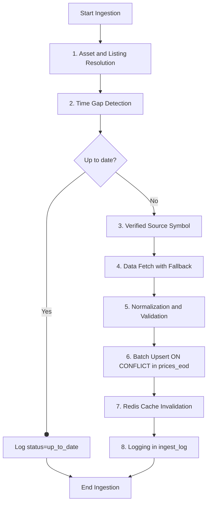
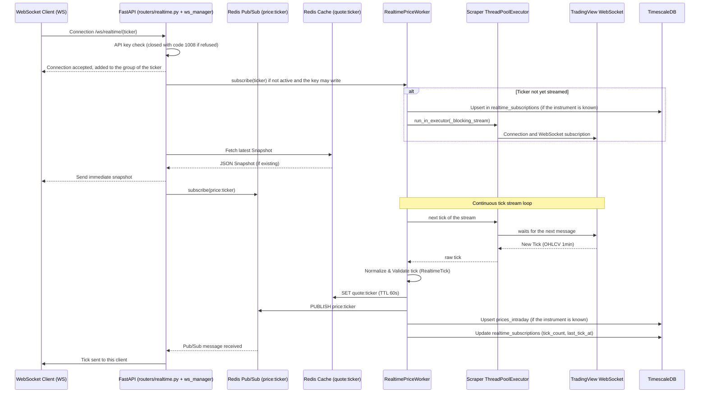

# Asset Import, EOD Ingestion, Real-Time Streaming and Technical Indicators

This document covers the CSV catalogue import, duplicate cleanup tools, the end-of-day price ingestion pipeline (`HistoricalIngestionService`), real-time TradingView streaming (`RealtimePriceWorker`), and on-the-fly technical indicator calculations (`TechnicalIndicatorService`). See [ARCHITECTURE.md](../ARCHITECTURE.md) for the routes and module map.

## Asset Import

### Custom CSV Asset Import (`import_assets.py`)

`import_assets.py` is an ISIN-deduplicated import pipeline for CSV files located in `data`. Without `--file` nor `--dir`, it imports `data/etf.csv` and `data/stocks.csv` when they exist, otherwise every CSV file of `data/isin_data/`.

Typical command in Docker:
```bash
# Standard import
docker compose exec fonrex-api python import_assets.py --file data/etf.csv

# Simulation without writing
docker compose exec fonrex-api python import_assets.py --file data/etf.csv --dry-run

# Every CSV file of a directory
docker compose exec fonrex-api python import_assets.py --dir data/isin_data

# yfinance enrichment only, for one instrument or for the instruments of a file
docker compose exec fonrex-api python import_assets.py --enrich-only --isin US0378331005
docker compose exec fonrex-api python import_assets.py --enrich-only --file data/etf.csv --limit 100
```

`--enrich-only` needs `--isin` or `--file`: it does not walk the whole catalogue. `--batch-size` (default 200) sets the number of rows per transaction and `--verbose` the detailed log.

The script resolves `--file` portably:
- Absolute path: used as is.
- Existing relative path: path relative to the current directory.
- Simple name: `/app/data/isin_data/<name>` in the container, then `/app/<name>`.

#### `AssetImporter` Pipeline

```
parse_csv(file_path)
  → List[CSVRow]  (validation + dedup on isin|ticker|currency key)
       ↓
AssetImporter.run(rows)
  → _process_batch()  per BATCH_SIZE_IMPORT chunk
       ↓ grouping by ISIN
    _upsert_asset()          — 1 Asset per ISIN (INSERT or UPDATE)
    _upsert_listing()        — 1 AssetListing per (asset_id, ticker, exchange, currency);
                               a row without exchange matches any stored exchange
    _create_default_mappings() — YahooFinance + GoogleFinance
       ↓
    commit() if not dry_run
```

Validation steps in `parse_csv`:
- `name` not empty, `ticker` ≤ 20 characters.
- `isin`: regex `[A-Z]{2}[A-Z0-9]{10}`.
- `productType` ∈ `{STOCK, ETF}`, `currency`: 3 uppercase letters.
- Deduplication on key `(isin, ticker, currency)` — same ISIN / different currencies = two valid `CSVRow`s.

Primary listing logic (`determine_is_primary`):
1. First listing → `is_primary = True`.
2. Primary already exists → `False`.
3. Currency in `PRIMARY_CURRENCIES` {USD, GBP, JPY, CHF, CAD, AUD} and no primary yet → `True`.

Listing matching (`_upsert_listing`): a row whose exchange is known (from the file or from the suffix of its ticker) matches the listing of that exchange only. A row without exchange matches the listing of the same instrument, ticker and currency whatever its exchange, the primary one first, then the oldest: the enrichment fills the blank exchange of an imported listing, and importing the file again must not create a second one. `scripts/clean_listing_duplicates.py` removes the duplicates that older imports created this way.

The import itself makes no network call. The `YahooFinance` mapping it creates is the ticker of the file, marked `source = 'csv_import'` and not verified: it is replaced by the verified symbol the first time the listing is ingested or asked for its fundamentals (see [Source Symbol](#3-source-symbol-historicalyahoo_symbolspy)). `--enrich-only` is a separate step: it runs the deep enrichment of `financials/enrichment/yfinance_enricher.py` (highlights, statements, earnings, ratings…) for one instrument or for the instruments of a file. Yahoo is asked with the symbol verified for the primary listing of the instrument (the same resolver as the price ingestion); an instrument without a verified symbol is left as it is, and the log says why.

The module also holds the Yahoo metadata lookup (`fetch_yfinance_data`, used by the profile enrichment of `/fundamental`), a logo download that nothing calls (`download_logo`, `LOGO_TOKEN`) and the row-level helpers (`get_or_create_asset`, `get_or_create_listing`, `upsert_mapping`) kept for `tests/test_asset_listings_import.py`.

The import runs at API startup only when `SEED_ON_FIRST_RUN=true` and the `assets` table is empty (`entrypoint.sh`); otherwise it is run by hand or with `make db-seed`.

### ISIN Duplicates Cleanup (`scripts/clean_isin_duplicates.py`)

Standalone tool intended for existing databases before or after migration 009.

```bash
# Diagnostic (read only)
docker compose exec fonrex-api python scripts/clean_isin_duplicates.py --diagnose-only

# Rehearsal: the cleanup is executed, then rolled back
docker compose exec fonrex-api python scripts/clean_isin_duplicates.py --dry-run

# Cleanup + unique index (production)
docker compose exec fonrex-api python scripts/clean_isin_duplicates.py --create-index

# Specific ISIN
docker compose exec fonrex-api python scripts/clean_isin_duplicates.py \
  --isin US0378331005 --diagnose-only
```

Cleanup steps (`clean_duplicates`):
1. Re-parent `asset_listings` to the canonical asset `MIN(id)` per ISIN.
2. Delete `asset_mappings` that became duplicates after re-parenting.
3. Delete `asset_listings` that became duplicates.
4. Delete duplicated assets that are now without listings.

`--create-index` creates, when they are missing, the unique index `uq_assets_isin_not_null` and the constraint `uq_asset_listing_identity`.

### Listing Duplicates Cleanup (`scripts/clean_listing_duplicates.py`)

Before the importer matched a row without exchange on any stored exchange, importing a file again after its enrichment created a second listing (`exchange = ""`) next to the enriched one, with its own mappings. A duplicate is a listing with an empty exchange when an older listing of the same instrument, ticker and currency exists; the oldest one is kept.

```bash
# Rehearsal: the cleanup is executed, then rolled back
docker compose exec fonrex-api python scripts/clean_listing_duplicates.py --dry-run

# Cleanup
docker compose exec fonrex-api python scripts/clean_listing_duplicates.py

# Specific ISIN
docker compose exec fonrex-api python scripts/clean_listing_duplicates.py \
  --isin US0378331005 --dry-run
```

- A duplicate without prices is deleted; its `asset_mappings` rows go with it (cascade).
- A trusted Yahoo mapping of the duplicate (verified, or set by hand, the rule of `is_trusted_symbol()` in `historical/yahoo_symbols.py`) goes to the kept listing when that one has none, or only an untrusted one (symbol not found, switched off). The duplicate is often the former primary listing, the one that was ingested: without its symbol the kept listing would not be ingested (rule 13 of `AGENTS.md`), and a symbol set by hand would be lost.
- Without `--move-prices`, a duplicate that holds prices is listed in the report and left alone: `prices_eod.asset_listing_id` does not cascade. Prices are checked again right before each delete, with the listing row locked, so the script can run while the scheduler ingests: a duplicate that received prices in the meantime is reported, not deleted.
- When the deleted duplicate was the primary listing, the kept listing becomes primary.

A duplicate usually holds prices because it was a primary listing of its instrument (older imports could give an instrument several): the ingestion fetched them for the same instrument and currency as the kept listing. The report says whether the kept listing has prices. `--move-prices` hands them to the kept listing, then deletes the duplicate:

```bash
# Rehearsal first: the report gives the bars moved and dropped per listing
docker compose exec fonrex-api python scripts/clean_listing_duplicates.py --move-prices --dry-run
docker compose exec fonrex-api python scripts/clean_listing_duplicates.py --move-prices
```

- Each series (resolution) of the duplicate is checked on its own. When the kept listing holds bars at that resolution, the two series must agree on every shared session (close within 1 %; a close missing on one side only is a difference, so a bar without close never wins over one with a close; a session without close on both sides compares nothing and does not count as shared), and enough sessions must be compared: five (`MIN_SHARED_SESSIONS`) as soon as the duplicate series holds more bars than that, so that one matching bar never carries thousands of bars nobody compared, however short the kept series is; a duplicate series of five bars or fewer needs as many compared sessions as the shorter of the two series holds, whatever their dates, so one whose bars fall outside the kept series' dates compares nothing and is reported rather than moved, even when the kept listing has a trusted Yahoo symbol.
- When the kept listing holds no bar at a resolution, nothing can be compared. That series moves only if the kept listing ends up with a trusted Yahoo symbol (its own, or the one handed over): the kept listing is then ingested, and the series is fetched again in full and replaced. Without one, bars fetched before rule 13 with a guessed ticker would become the kept listing's prices for good, so the duplicate is reported instead.
- All or nothing: if one series of a duplicate fails, nothing moves and the duplicate is reported with the comparison of each resolution (sessions compared, required and different). It may hold another instrument's series, fetched with a symbol that was not verified. Check it by hand before deleting its bars.
- Otherwise the bars whose `(resolution, time)` the kept listing does not have are copied to it, then every bar of the duplicate is deleted. On a shared session the kept bar stays, and only the fields it lacks (`open`, `high`, `low`, `adj_close`, `volume`) are taken from the duplicate's bar (`INSERT … SELECT … ON CONFLICT DO UPDATE SET field = coalesce(kept, duplicate)`, only where a field is missing). The bars are copied rather than updated in place because the listing is part of the key and of the compression segments of `prices_eod`. The counts of the report come from one aggregate over the duplicate's bars and the `rowcount` of the delete, so nothing else is counted while both listings are locked.
- The closes are only compared within 1 %, and a dividend changes `adj_close` alone: the moved bars and fields may follow another adjustment basis than the kept ones. So each series of the kept listing that receives bars or fields loses its `price_series_adjustments` row, and the next ingestion fetches it again in full, on one basis (see `historical/adjustment.py`). When the kept listing had no bars, the row of the duplicate goes with it (cascade) and the same full fetch follows.
- Both listings are locked during the move, so an ingestion that writes either series waits for the end of the run. An ingestion that read the kept series before the lock may still record its adjustment scheme after the commit, on a series that holds moved bars: pause the scheduler while `--move-prices` runs.
- After the commit, the script refreshes `prices_weekly` and `prices_monthly` on the range of each duplicate's bars, dropped ones included, one refresh per range (overlapping ranges merged): two duplicates from 1995 and 2025 do not refresh the thirty years between them. A refresh cannot run inside a transaction. If that refresh fails, the cleanup stays committed and the daily job of the aggregates catches up.

## EOD And Historical Data

The `prices_eod` table (TimescaleDB hypertable) is the single source of end-of-day prices: every route reads it, and only the ingestion service writes it (apart from `scripts/clean_listing_duplicates.py --move-prices`, which hands the bars of a duplicate listing to the kept one).

### Historical Data Paths

- **Read**: `GET /ticker/{symbol}/history` calls `QueryService.get_history()`, which reads the bars of the listing stored at the requested resolution; for `1W` and `1M`, when no bar is stored at that resolution, it reads the `prices_weekly` / `prices_monthly` aggregates computed from the daily bars. This route never ingests: a listing that was never ingested answers an empty list.
- **Read with ingestion**: `GET /eod/{ticker}` follows the same read path with a distinct response formatting (JSON/CSV, configurable order). When the read returns **nothing** for the requested range, it ingests the listing and reads again; stored prices that are merely out of date are served as they are.
- **Write / Ingestion**: `POST /historical/ingest` (unit) or `POST /historical/ingest/bulk` (multi-asset) calls `HistoricalIngestionService` to feed `prices_eod`. `scripts/ingest_all.py` does it for the whole catalogue.

The technical indicators read `prices_eod` at the requested resolution only: a weekly or monthly indicator needs bars ingested at `1W` or `1M`, it does not use the aggregates.

### Historical Ingestion Pipeline (`HistoricalIngestionService`)

When an ingestion process is launched for an asset, the following steps are executed:



#### 1. Series Resolution (`_resolve_asset`)
The requested ticker is resolved to a price series — an instrument and one of its listings — by `database/price_series.py`: the listing bearing that ticker (primary first, then by currency, exchange and id), otherwise the preferred listing of the instrument whose own (legacy) ticker it is; then the same two lookups without the ticker suffix (`AIR.PA` → `AIR`), on the place the suffix names only. The history and EOD routes, the technical indicators (among active listings only) and the canary price ranges use the same rule, so the series that is read is the one that was written. The Zipline bundle has its own query (see its section). An instrument without any listing has no price series and cannot be ingested.

#### 2. Time Gap Detection (`_detect_gaps`)
The service queries `QueryService.get_history_range()` to obtain the minimum and maximum dates present in the database for this asset and resolution. 
- If no data is present, the system fetches the default history (up to 10 years).
- If the maximum date in the database corresponds to today or yesterday, the asset is marked as up to date.
- Otherwise, the system performs an incremental ingestion starting from the day after the maximum date up to today.
- A `from_date` older than the first stored date is fetched even when the series is up to date: the range from `from_date` to the day before the first stored date.
- With `force_refresh` nothing is compared: the requested range (ten years by default) and the stored range are fetched again in one piece.

#### 2b. One Adjustment Basis per Series (`historical/adjustment.py`)
Yahoo adjusts a whole history again after each split (`open`, `high`, `low`, `close`) and each dividend (`adj_close`). A series is written in one piece, then completed bar by bar; adding new bars to stored ones adjusted on an older basis would create a false return where they meet (about minus the dividend yield, or -75 % after a four-for-one split). `fetch_on_one_basis()` prevents it:
- `price_series_adjustments` records, per listing and resolution, the scheme of the stored bars (`close:splits;adj_close:splits+dividends`) and when the series was last fetched in one piece. It is written after a first ingestion and after each full fetch.
- To complete a series, the window is fetched together with the last five stored bars (the first five when older sessions are asked). If the source gives the same prices for them (relative difference up to 1e-4), only the sessions outside the stored range are written. If not — a split or a dividend since the last ingestion — the stored range and the window are fetched again in one piece and replace the stored bars; if that fetch fails, nothing is written and the ingestion fails with the reason.
- A stored bar without `adj_close` (TradingView) while the source now gives one also triggers a full fetch, so that the dividend-adjusted prices of the series are all on one basis.
- A series without a recorded scheme (stored before migration 016, when `close` held the dividend-adjusted price) is fetched again in full at its next ingestion; `scripts/ingest_all.py --force` does it for the whole catalogue.
- The result says why a whole series was fetched again in `note` (`Whole history fetched again: ...`).

#### 3. Source Symbol (`historical/yahoo_symbols.py`)
A ticker of the catalogue is not a Yahoo symbol: `SPFF` is a bond UCITS ETF in EUR in the catalogue and a US fund in USD on Yahoo; `EUCO` is `SYBC.DE` on Yahoo. Before any fetch, the symbol of the listing is resolved by `YahooSymbolResolver`:

1. a symbol already verified (or set by hand, `source = 'manual'`) in the `YahooFinance` row of `asset_mappings` is reused;
2. otherwise Yahoo is searched by the **ISIN** of the instrument; the candidates are ranked (same ticker first, traded lines before fund lines, then Yahoo's score) and the first one quoted in the **currency of the listing** with an existing price is kept;
3. failing that, a ticker that names its exchange (`GOVY.SW`) is tried as it is; a ticker without suffix only for an instrument with no ISIN or a North-American one (a Yahoo symbol without suffix is a North-American listing);
4. the answer is stored in the mapping: the symbol, `source` (`isin_search` or `ticker_check`) and `last_verified_at` on success; on failure the mapping is switched off (`source = 'symbol_not_found'`) and the listing is not looked up again for 24 hours, unless `force_refresh` is asked.

A listing without a verified symbol is not fetched from Yahoo: `GOVY` in CHF, for which Yahoo only has a EUR line, gets no price rather than the price of another line. An unreachable Yahoo concludes nothing and records nothing.

The SEC is asked the same way (`financials/sec_cik.py`): it files by company under a CIK, and `AIR` at the SEC is AAR Corp, not Airbus (`AIR.PA`). A CIK is looked up only for an instrument that has a **US listing** in the catalogue (quoted in USD, on a US exchange or on none named, with a ticker that names no foreign exchange: `BRK.B` is read `BRK-B`, `SAP.DE` is not looked up). The ticker must be in `company_tickers_exchange.json` on a US exchange, under a company **named** like the instrument (legal forms and classes of shares left out). The CIK is kept in the `SEC` row of `asset_mappings` without listing, shared by every listing of the instrument: SAP in Frankfurt gets the CIK of SAP SE through its NYSE listing. An instrument without US listing is not looked up; a failure is not asked again for seven days; funds and ETFs file no statements and are not looked up.

The European filings are found the same way (`financials/esef_lei.py`): filings.xbrl.org keeps them by Legal Entity Identifier, and GLEIF gives the LEI of an ISIN. The **ISIN** of the instrument is asked, never a ticker: `NL0000235190` is one security issued by Airbus, whatever `AIR` means elsewhere. An instrument without ISIN, of a type that files no annual report (ETF, fund, index, currency), or whose ISIN names a country outside the European Union, the European Economic Area, the United Kingdom and Ukraine (the countries whose filings filings.xbrl.org collects) is not asked about: a first reading of a catalogue of 6 000 shares asked GLEIF about 3 700 Japanese, Canadian, American… shares for nothing. The entity of GLEIF must still bear the name of the instrument, its legal name or one of its other names, the legal forms left out (`S.A.`, `SE`, `N.V.`, `S.p.A.`, `A/S`, `AB (publ)`, and in full: `SPÓŁKA AKCYJNA`, `SOCIETE ANONYME`, `AKTIENGESELLSCHAFT`…, at the end of a name only, `AB`, `AS` and `Oy` also at its start, so that the `A.G.` of `A.G. Barr` stays), the letters `ł`, `ø`, `æ`, `ß` written in Latin letters, and the names GLEIF writes in Latin letters for an entity named in another script (Greek companies); the same letters spaced otherwise are the same name (`Klea Holding` is `KLEAHOLDING`, `Broedrene` is `BRØDRENE`): `Novo Nordisk B` is `NOVO NORDISK A/S`, and a long legal name holding a name of two words or more is the same company (`Air Liquide` in `L'AIR LIQUIDE SOCIETE ANONYME POUR L'ETUDE…`); an ISIN given to several entities named alike is refused. The LEI is kept in the `LEI` mapping of the instrument (no listing), with its record on GLEIF as URL. A LEI set by hand (`source = 'manual'`) is trusted, even when GLEIF is asked again; a verified LEI is reused without asking; an instrument for which nothing was found is not asked again for 30 days; a LEI that GLEIF no longer confirms is switched off; when GLEIF does not answer, nothing is remembered.

#### 4. Data Fetch with Fallback (`HistoricalMarketDataFetcher.fetch`)
- **Yahoo Finance**: The main connector calls `yfinance` (blocking) through `concurrency.run_sync()` with `auto_adjust=False`: `open`, `high`, `low` and `close` are the traded prices as Yahoo publishes them (adjusted for splits only), `adj_close` is Yahoo's close adjusted for splits and dividends (the close when Yahoo gives none), with `adjusted = true`. Returns including dividends are computed from `adj_close`. A bar is dated by its trading session: yfinance returns midnight in the time zone of the exchange, and the date of that local midnight is kept (converting the instant to UTC would date every European or Asian session the day before).
- **TradingView (Fallback)**: In case of failure or limitations from Yahoo Finance (in `auto` mode), the system switches to a temporary WebSocket client connected to TradingView's realtime streams, resolving the symbol via `tradingview-scraper`. Bars are asked with the `splits` adjustment: their `close` is comparable with Yahoo's, and their `adj_close` is empty (readers fall back on `close`). The line is searched by the verified Yahoo symbol without its suffix, or by the ticker when the listing has none (TradingView is therefore tried for a listing that Yahoo does not know), and accepted only if it is quoted in the currency of the listing; a ticker written `EXCHANGE:SYMBOL` is used as it is; the result reports the symbol used (`provider_symbol`) and why Yahoo was not the source (`note`). After an ingestion every cached answer computed from the prices of the ticker is dropped (`history`, `eod`, `technical`, `dcf` keys).

#### 5. Normalization and Validation (`_normalize_bars`)
Received candles undergo quality filters:
- Exclusion of null or `NaN` values on Open, High, Low, Close.
- Automatic correction of inconsistencies (e.g. if `high < low`, the values are swapped; ensure `high` and `low` contain the absolute extremes of the candle).
- A negative volume is set to zero, a missing one too.
- A second bar with the same date is dropped.

#### 6. Optimized Batch Upsert (`_upsert_prices_eod`, `historical/price_writer.py`)
To quickly insert thousands of rows without saturating memory, normalized candles are split into blocks (`batch_size` default to 1000) and inserted via a Native PostgreSQL instruction `INSERT ... ON CONFLICT (asset_listing_id, resolution, time) DO UPDATE`. With `force_refresh`, or when the whole series was fetched again (step 2b), the stored bars of the same listing and resolution inside the fetched range are deleted first, in the same transaction: the range ends up holding exactly the fetched bars (no leftover from an earlier adjustment basis or a wrongly dated row). 

#### 7. Redis Cache Invalidation
Every cached answer computed from the prices of the ticker is dropped via asynchronous scan and delete operations (`SCAN` + `DEL`): the `history:`, `eod:`, `technical:` and `dcf:` keys of that ticker, in both forms a key may take (`XETR:SPFF` and `XETR_SPFF`). The screener results (`technical:screen:*`) are not tied to a ticker and expire on their own.

#### 8. Ingestion Logging (`_log_ingest`)
A detailed execution log is stored in the `ingest_log` table (job status, source used, number of rows added, date range, execution duration in ms, and optional error message).

### Bulk Ingestion

The `ingest_bulk` method handles processing multiple tickers in parallel:
- Concurrency limitation via an asynchronous semaphore: the `concurrency` field of the request (default 5, between 1 and 20). `INGEST_CONCURRENCY` only applies to a caller that passes nothing.
- Introduction of a short random delay (0.1 to 0.5 s) before each ticker, to avoid IP bans by data providers.
- The tickers are ingested without a listing choice: a ticker shared by several listings designates its primary one. A single ingestion accepts `currency` and `exchange`.

Settings: `INGEST_YF_DELAY` (0.5 s, pause before falling back to TradingView), `INGEST_BATCH_SIZE` (1000 rows per insert). `INGEST_TV_DELAY` is read and used by nothing.

## Real-Time Streaming

The system integrates a real-time price streaming pipeline connected to TradingView WebSockets, distributed to clients via Redis Pub/Sub, and persisted in TimescaleDB.

### Streaming Architecture



### Key Principles

1. **Worker Lifecycle**: The `RealtimePriceWorker` starts and stops cleanly via the FastAPI lifespan hook. On initialization, it queries the `realtime_subscriptions` table and automatically restores all active subscriptions.
2. **Lazy Load Subscription**:
   - Accessing `GET /quote/{ticker}` checks the Redis cache. If absent, it returns yfinance (delayed) prices; it triggers the subscription in the background only when asked with `subscribe_if_missing=true`.
   - Connecting to `WS /ws/realtime/{ticker}` immediately subscribes the ticker with the worker if necessary.
   - A read-only key never triggers a subscription, on either route: it is served what a full-access key (or `POST /realtime/subscribe`) already made the worker stream. On the WebSocket it first receives a `not_streaming` message when the ticker is not streamed.
   - `POST /realtime/subscribe` accepts 50 tickers per request.
3. **Throttling & Robustness (Backoff)**:
   - The thread pool is throttled to a maximum of simultaneous connections via a global semaphore (`TV_MAX_CONNECTIONS`, default 10).
   - In case of a network error or TradingView disconnection, the worker applies an automatic reconnection mechanism with exponential backoff (first delay `TV_RECONNECT_DELAY`, 5 seconds by default, doubled at each attempt up to a maximum of 60 seconds). A snapshot stays `REALTIME_QUOTE_TTL` seconds (60 by default) in Redis.
4. **One listener per connection**: each WebSocket connection subscribes to the `price:{ticker}` channel and sends every tick to its own client, once. The `ConnectionManager` (`ws_manager`) keeps the connections grouped by ticker for `GET /realtime/status`; its `broadcast` is no longer on the path of a tick (it delivered each tick once per connected client), and the server sends no ping of its own (`broadcast_ping` exists and is never called). A client may send `ping` (answered `{"type": "pong"}`) or `unsubscribe` (closes the connection).
5. **TradingView symbol**: the worker derives the TradingView exchange from the suffix of the ticker (`AIR.PA` → `EURONEXT:AIR`, `.DE` → `XETRA`…, `TV_EXCHANGE_MAP`); a ticker without suffix is taken for a NASDAQ line. Unlike the end-of-day ingestion, the realtime path does not verify the line against the ISIN and the currency of a listing: the instrument is looked up by its legacy ticker in `assets`, intraday candles are stored per instrument (`prices_intraday.asset_id`), and the listing choice of the price routes (`currency`, `exchange`) does not exist here.
6. **One process**: subscriptions, streams and the connection manager live in the memory of the API process, which is why the API runs a single worker by default.

## Technical Indicators

The system integrates an on-the-fly technical indicator calculation engine powered by the `pandas-ta` library and leveraging historical data stored in TimescaleDB.

### Supported Indicators & Categories
The engine dynamically calculates **18 technical indicators** divided into four fundamental categories:
- **Trend**: SMA, EMA, WMA, DEMA, TEMA, VWAP (VWAP available only on intraday data with daily reset).
- **Momentum**: RSI, MACD, Stochastic, CCI, ROC, MOM.
- **Volatility**: Bollinger Bands, ATR, Keltner Channels.
- **Volume**: OBV, A/D Line, MFI.

### Calculation Cycle
1. The ticker is resolved to its price series with `database/price_series.py`.
2. The last `limit` bars of the series are loaded (`TECHNICAL_DEFAULT_LIMIT`, 500 by default, between 10 and 5000), or the bars between `from_date` and `to_date`.
3. The engine refuses the calculation when the series is shorter than the indicator needs (`InsufficientHistoricalData`, HTTP 422).
4. `pandas-ta` computes the indicator on those bars. No extra bar is loaded before the requested window: the first values of a series, for which the indicator does not have enough history yet, are returned as `null`, and an exponential average (EMA, MACD, RSI) converges over the first bars of the window. A caller that needs converged values on a period asks for a longer window.

Domain errors are translated at the HTTP boundary: unknown indicator or resolution not supported by the indicator → 400, no data → 404, not enough data or failed calculation → 422.

### Performance Optimization
1. **Single DataFrame (Multi-calculation)**: The `calculate_multi` method allows calculating a list of indicators in a single pass. OHLCV data of the asset is read once from the database (TimescaleDB) as a `DataFrame`, then each indicator is calculated in memory on this same `DataFrame`, thus avoiding redundant SQL queries.
2. **Bounded concurrency**:
   - `POST /technical/batch` accepts at most `TECHNICAL_MAX_BATCH_TICKERS` tickers (20) and `TECHNICAL_MAX_BATCH_INDICATORS` indicators (10), and computes five tickers at a time (`Semaphore(5)`).
   - `GET /technical/screen` evaluates one indicator on a **sample** of the catalogue, not on all of it: the primary active listings of at most `2 × limit` instruments that have prices, `limit` listings at most (50 by default), 25 calculations at a time. The result is cached 15 minutes.

### Redis Cache Strategy
Indicator calculation results are transparently cached in Redis with time-to-live (TTL) tailored to the data granularity:
- **End-Of-Day (EOD) Data**: 3600 seconds for `1D`, 7200 for `1W`, 14400 for `1M` (`technical/catalog.py`).
- **Intraday Data**: 60 seconds for `1min`, 120 for `5min`.
- Only the single-indicator calculation (`GET /technical/{ticker}`, also used by the screener) reads this cache. The multi-indicator, chart and batch routes compute every time and store each indicator for the single route.
- The key is `technical:{TICKER}:{resolution}:{indicator}:{parameters}`, followed by the dates when given and by the number of bars loaded (`limit`): two windows are two entries.
- `TECHNICAL_CACHE_ENABLED=false` switches this cache off. A Redis read or write error is logged and the calculation goes on without cache.
