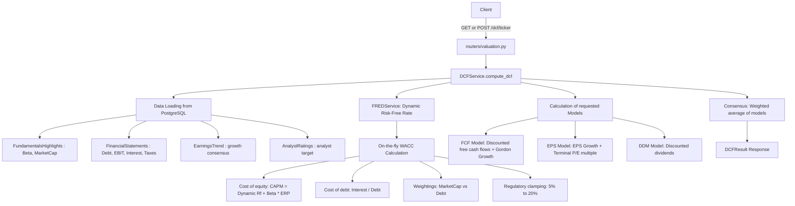

# Factor Returns, DCF Valuation, Macro Series and Official Filings (SEC / ESEF)

This document covers the Kenneth French factor library and exposure regressions (`factors/`), the DCF/WACC valuation engine (`valuation/`), macro-economic series (FRED, ECB, Eurostat, US Treasury yield curves, CFTC Commitments of Traders), and XBRL statement extraction from SEC EDGAR and European ESEF filings. See [ARCHITECTURE.md](../ARCHITECTURE.md) for the routes table.

## Factor Returns (Kenneth French Data Library)

Fonrex keeps the factor returns of the [Kenneth R. French Data Library](https://mba.tuck.dartmouth.edu/pages/faculty/ken.french/data_library.html) in `factor_returns`, to measure the factor exposure of a listing. Nine datasets are known (`factors/french_library.py`), each monthly and daily:

| Dataset | Factors | Library files |
| --- | --- | --- |
| `us_3`, `europe_3`, `developed_3` | `MKT_RF`, `SMB`, `HML`, `RF` | `F-F_Research_Data_Factors`, `Europe_3_Factors`, `Developed_3_Factors` |
| `us_5`, `europe_5`, `developed_5` | `MKT_RF`, `SMB`, `HML`, `RMW`, `CMA`, `RF` | `F-F_Research_Data_5_Factors_2x3`, `Europe_5_Factors`, `Developed_5_Factors` |
| `us_mom`, `europe_mom`, `developed_mom` | `MOM` (`Mom` or `WML` in the files) | `F-F_Momentum_Factor`, `Europe_Mom_Factor`, `Developed_Mom_Factor` |

The daily files add `_daily` (US) or `_Daily` to the name. A file is a zipped CSV: notes, a header (`,Mkt-RF,SMB,HML,RF`), one row per period (`192607` for a month, `19260701` for a day), then annual factors, which are not read. Values are published in percent and stored as ratios (`2.89` → `0.0289`); `-99.99` and `-999` mark a missing value, which is not stored. A month is dated by its last day.

Every return of the library is **in US dollars**, the European and developed datasets included, and `RF` is the US one-month Treasury bill rate for every region: a listing quoted in another currency must be compared in dollars.

`FactorLibrary.refresh()` downloads a file and stores it whole in place of the previous one (the library revises past values), with its date in `factor_dataset_loads`; a file read less than `FACTORS_REFRESH_DAYS` days ago is not downloaded again unless forced, and a failed download leaves the stored values as they were. `POST /factors/refresh` (`dataset`, `frequency`, `force`) and `scripts/load_factors.py` run it; `GET /factors/{dataset}` downloads a file first when it was never downloaded or is older than `FACTORS_REFRESH_DAYS`, and answers what is stored when the download fails (`load.status` = `failed`, `503` when nothing is stored). `GET /factors` lists the datasets and what is stored of each file, downloading nothing. From the command line:

```bash
docker compose exec fonrex-api python scripts/load_factors.py --dataset us_3 europe_3 --frequency monthly daily
```

**Factor exposure.** `GET /factors/exposure/{ticker}` regresses the excess returns of a listing on the factors of its region: r − RF = α + Σ βₖ·Fₖ + ε, by ordinary least squares with classical standard errors (`factors/exposure.py`, numpy only). `model` is `ff3` (MKT_RF, SMB, HML), `ff5` (plus RMW, CMA) or `carhart` (ff3 plus MOM, from the momentum dataset of the region).

- **Listing and prices.** The ticker is resolved like the price routes (`currency`, `exchange`, `isin` name one listing); its daily closes are read from `prices_eod` (`adj_close`, dividends included, else `close`). A listing without stored prices answers `404`: ingest it first.
- **Dollars.** The factors are in US dollars: a close quoted in another currency is converted with the ECB reference rate of its day, or the last one within a week (`converted_from`); pence are pounds. The rates of the currency and of the dollar are refreshed first when needed.
- **Region.** USD listings take the US factors, the European currencies (EUR, GBP, CHF, SEK, DKK, NOK…) the European ones, the others the developed markets; `region` overrides it.
- **Periods.** A monthly return goes from the last close of a month to the last close of the next month (a month without close breaks the chain); a daily return from one close to the next. The regression keeps the last `window` periods (60 months or 252 days by default) that have a return and every factor, up to `end`; fewer than 24 months or 60 days answers `422`, fewer than 36 months or 126 days adds a warning. The monthly factors are published with a delay of one or two months: the last period is the last month the library covers.
- **Answer.** `betas` (value, standard error, t statistic), `alpha` per period and annualised (× 12 or × 252), `r_squared`, `adj_r_squared`, the annualised volatility of the residuals, the periods used and `warnings`.

**Exchange rates.** To compare a listing quoted in another currency with these dollar returns, `macro/fx_rates.py` keeps the ECB reference rates of the euro day by day in `fx_rates` (`EXR/D.{currency}.EUR.SP00.A`, free, without key, from 1999): `per_eur` is the number of units of the currency for one euro. A refresh asks only for the days after the last one stored, starting a week earlier to take a late correction, and a currency read less than `FX_RATES_REFRESH_HOURS` hours ago is not asked again. `EcbExchangeRates.rates(base, quote)` gives the rate between any two currencies through the euro, on the days both are known (dollars per pound = USD per EUR / GBP per EUR). The default currencies are USD, GBP, CHF, SEK, DKK, NOK, JPY, CAD, AUD and HKD:

```bash
docker compose exec fonrex-api python scripts/load_fx_rates.py --currency USD GBP CHF
```

| Variable | Default | Description |
| --- | --- | --- |
| `FACTORS_REFRESH_DAYS` | `7` | Days before a factor file is downloaded again (1 to 90); the library is updated about once a month |
| `FRENCH_LIBRARY_URL` | `https://mba.tuck.dartmouth.edu/pages/faculty/ken.french/ftp` | Address of the library files; set only to use a mirror |
| `FX_RATES_REFRESH_HOURS` | `12` | Hours before the ECB exchange rates of a currency are asked again (1 to 720) |

## Financial Valuation and DCF Models

The financial valuation module calculates the theoretical intrinsic value of an asset by crossing three classic Discounted Cash Flow (DCF) methodologies, supplemented by dynamic Weighted Average Cost of Capital (WACC) calculation and sensitivity analysis.

### Calculation Architecture



The service computes from what the database already holds: the highlights, the annual financial statements, the earnings trend and the analyst ratings written by the deep enrichment (`GET /fundamental/deep`), and the latest daily close of the main listing. It fetches nothing itself: a ticker that was never enriched answers `404` with the name of the missing data.

The statements are read as **fiscal years**: the three rows of a year (income statement, balance sheet, cash flow) are put together by `financials/fiscal_years.py`, and the valuation looks back on the last five fiscal years. "The latest statement" is therefore a whole year — the debt and the cash of its balance sheet, the interest, the tax and the operating profit of its income statement, the dividends of its cash-flow statement. The enrichment stores those figures (`EBIT`, `Interest Expense`, `Tax Provision`, average share counts, dividends paid) since this rule exists; an instrument enriched before keeps them empty until `GET /fundamental/deep?refresh=true`, and the valuation uses its documented defaults meanwhile.

### Currency of the valuation

A valuation is made in the **currency of the statements** (`valuation/currency.py`): the enrichment records Yahoo's `financialCurrency` on every row of `financial_statements.currency` (migration 018 made the rows stored before unknown, `NULL`, instead of a `USD` written by default). When the statements name none, the valuation takes the currency of the listing of the share price, then the currency of the instrument, then USD. The answer gives it in `currency`, and the currency of the listing whose last close is the share price in `price_currency`.

- **Risk-free rate of that currency.** The cash flows are discounted with the rate of their currency: EUR uses the ECB AAA 10-year rate (`ecb_*`), USD the FRED 10-year Treasury rate (`fred_*`), or the 10-year rate of the Treasury par yield curve when FRED gives none (`treasury_*`). Another currency, or a currency whose source gives nothing, uses `DCF_RISK_FREE_RATE` (`env_fallback`): a euro company is never discounted with the US rate. `wacc.risk_free_rate_currency` names the currency of the rate used, and is empty for the configured rate and for a rate given in the request.
- **Price in the same currency.** A price quoted in a minor unit is turned into its major one (`GBX`/`GBp` pence into GBP, `ZAC` into ZAR, `ILA` into ILS) before it is compared with the intrinsic value. A price in another currency (a US listing of a European company) is not converted: `consensus_upside_pct`, the `upside_pct` of each model and of each sensitivity cell are then empty, and `warnings` says why.
- **Upside of each model.** `models.{fcf,eps,ddm}.upside_pct` is the upside of that model's value over the price (it used to be 0).

### Cost of equity from the Fama/French factors

`POST /dcf/{ticker}` accepts `wacc_params.cost_of_equity_model`: `capm` (the default, Rf + beta × equity risk premium), or `ff3`, `ff5`, `carhart`, which replace the cost of equity by Rf + Σ βₖ × premiumₖ (`factors/cost_of_equity.py`):

- the betas are the exposure of the listing measured by `GET /factors/exposure/{ticker}` on 60 months of returns in US dollars (`factors/exposure.py`): the valuation needs the daily prices of the listing and the factor files, downloaded when missing;
- the premia are the long-run premia of the factors of its region: the mean of all the stored monthly returns of each factor, times twelve (US since 1926 or 1963, Europe since 1990);
- Rf stays the risk-free rate of the currency of the cash flows. The premia are excess returns in dollars over the US T-bill: for a valuation in another currency they are an approximation, said in `warnings`;
- the WACC is computed again with this cost of equity (within 5–20 %), `beta_used` is the market beta, and `wacc.factor_cost_of_equity` gives the betas, the premia, Σ β × premium, the months of the regression and its R². `beta_override` and `equity_risk_premium` belong to the CAPM and are not used (a warning says so); a cost of equity below Rf is said too;
- an exposure that cannot be measured (no prices, too short a history, no factor file) answers `404` with the reason, like a missing input of the valuation.

The GET routes of the DCF keep the CAPM. Factor premia are estimated with a large error and change with the period: this cost of equity is a second opinion asked for, not the default.

### Supported Models Detail

1. **Free Cash Flow (FCF) Model**: 
   - Starts from the average of the free cash flows of the last three fiscal years (when none is published: operating cash flow minus capital expenditures, or net income) and projects it over $N$ years (default 5 years, configurable from 3 to 10 years). The growth rate is the historical FCF growth, failing that the revenue growth, bounded to 0–20 %, failing that 4 %.
   - Calculates terminal value applying the Gordon Growth Model (perpetual growth).
   - Deducts net debt (Total Debt - Cash) from the Enterprise Value to get the equity value, then divides by the number of outstanding shares to get the intrinsic value per share.

2. **Earnings Per Share (EPS) Model**: 
   - Estimates EPS growth over the projection period from historical growth rate and analyst consensus (`EarningsTrend`), moving linearly towards the terminal growth rate.
   - Calculates future terminal value using a terminal P/E multiple: the current P/E of the company (trailing, else forward) bounded to 10–30, or 15 when it is unknown.
   - Discounts the projected EPS and terminal price at the cost of equity (CAPM) to get the stock's fair value.

3. **Dividend Discount Model (DDM)**: 
   - Gordon discount model on projected dividends.
   - Requires actual dividend distribution by the company. Without a dividend the model cannot be applied: asked alone it is an error, and `GET /dcf/{ticker}/compare` then returns the two other models with a zero-valued DDM entry carrying the warning.

### FRED Macro-Economic Service

The `FREDService` provides the 10-Year Treasury Constant Maturity Rate (`DGS10`), used as the risk-free rate in WACC calculations. It looks, in this order, at Redis (6 hours, `MACRO_RATES_CACHE_TTL`), at the value stored in `macro_rates_cache` when it was read from FRED less than that lifetime ago, then at the FRED API (`FRED_API_KEY`). A stored value that is older is only what is left when FRED cannot be asked (no key) or does not answer. An observation FRED already gave is confirmed in place — value and date of reading — instead of adding a row. Rates are ratios (`0.0412` for 4.12 %, `unit` = `ratio`; rows stored before say `percent` and are read as ratios) and may be zero or negative. Each rate says how fresh it is (`freshness`): `live` (read from FRED for this answer), `cached` (Redis, or stored and read from FRED less than one cache lifetime ago) or `stale` (an older stored value: no key, or no answer; it is not put in Redis, so FRED is asked again next time). When FRED gives no rate (no key and nothing stored, or no answer) or only a `stale` one, the 10-year rate of the latest Treasury par yield curve is used (`macro/treasury_curves.py`, read first when needed, series `treasury:nominal:10Y`, `source` = `treasury`), unless the stale FRED value is more recent: FRED republishes this rate (`DGS10`), and the Treasury publishes it without key. Its freshness is `live` when the current year was read for the answer, `cached` when it was stored and up to date, `stale` when the Treasury could not be read. Without any value, the risk-free rate is `DCF_RISK_FREE_RATE` (4 % by default, read once at start-up). The WACC reports the rate used (`risk_free_rate`), its source (`risk_free_rate_source`: `fred_live`, `fred_cached`, `fred_stale`, `treasury_live`, `treasury_cached`, `treasury_stale`, `env_fallback` or `client_override`) and its observation date (`risk_free_rate_date`).

The `ECBService` reads the series of the European Central Bank Data Portal (`https://data-api.ecb.europa.eu/service/data/{flow}/{key}?lastNObservations=5&format=csvdata`, free and without key; `ECB_API_URL` replaces the address) through the same cache as FRED (Redis key `macro:ecb:{flow.key}`, `macro_rates_cache` with `source = 'ecb'`). It keeps the latest observation with a value: the 10-year spot rate of the AAA euro area government yield curve (`YC.B.U2.EUR.4F.G_N_A.SV_C_YM.SR_10Y`, the euro risk-free rate), the deposit facility rate (`FM.D.U2.EUR.4F.KR.DFR.LEV`) and the Composite Indicator of Systemic Stress (`CISS.D.U2.Z0Z.4F.EC.SS_CIN.IDX`, an index stored as published). `get_euro_risk_free_rate()` reports `ecb_live`, `ecb_cached` or `ecb_stale`, or nothing when no value is known: the caller chooses the fallback.

`GET /macro/rates` gives the rates of both sources, each tagged with its `source` (`fred`, `ecb`) and its `currency` (`USD`, `EUR`): `rates` lists the US 10-year Treasury rate, then the euro AAA 10-year rate, the deposit facility rate and the CISS (an index, not a ratio). `currency=USD` or `currency=EUR` keeps the series of one source; another currency answers `422`, as no source publishes its rates. `risk_free_rate` is the 10-year rate of the currency asked, the US one when none is asked (the answer before the ECB was a source). A source that did not start is left out (`503` when it is the only one asked, or when none started). `GET /openbb/macro/rates` takes the same `currency` (empty: both) and shows one card per series: rates as percentages, the CISS with four decimals, the date of the observation and `stale` when the value is an older stored one.

**Eurostat indicators.** `EurostatService` (`macro/eurostat_service.py`) reads seven indicators of Eurostat in SDMX-CSV (`https://ec.europa.eu/eurostat/api/dissemination/sdmx/2.1/data/{flow}/{key}?format=SDMX-CSV`, free and without key; `EUROSTAT_API_URL` replaces the address), by country or area: `hicp` and `hicp_core` (annual rate of the HICP, all items and excluding energy, food, alcohol and tobacco, flow `prc_hicp_minr` of the ECOICOP 2 classification), `unemployment` (`une_rt_m`, seasonally adjusted), `gdp_qoq` and `gdp_yoy` (`namq_10_gdp`, chain-linked volumes, on the previous quarter and on the same quarter of the previous year), `economic_sentiment` and `consumer_confidence` (`ei_bssi_m_r2`). Rates are stored as ratios; the sentiment indicator (an index, 100 the long-term average) and the confidence (a balance of answers) as published. The euro area is `EA21`, its composition since 2026 (`EA` is read as `EA21`): the flows of the labour market and of the surveys have no code for a changing composition. The series are kept in `macro_observations`, a period dated by its first day; the first reading takes the whole series, the next ones the last 24 months (8 quarters for GDP) again, so that a revision replaces the value of its period, and a series read less than `EUROSTAT_REFRESH_HOURS` hours ago (24 by default) is not asked again. A refusal of Eurostat (an unknown code answers 400) is reported with its reason, and the stored values stay. `GET /macro/indicators` gives the latest value of each indicator for one country, with the previous period and the change; `GET /macro/indicators/{indicator}` the series of up to 10 countries; both read a missing or old series first. `POST /macro/indicators/refresh` reads series on demand.

**US Treasury yield curves.** `TreasuryProvider` (`financials/providers/treasury.py`) reads the daily par yield curves of the US Treasury, one CSV file per year and curve (`https://home.treasury.gov/resource-center/data-chart-center/interest-rates/daily-treasury-rates.csv/{year}/all?type=...`, free and without key): the nominal curve since 1990 (`daily_treasury_yield_curve`, 1 month to 30 years, the maturities published changing over the years) and the real curve since 2003 (`daily_treasury_real_yield_curve`, TIPS, 5 to 30 years). Rates are ratios; a column the Treasury adds is refused, never ignored. `TreasuryCurves` (`macro/treasury_curves.py`) keeps them in `yield_curve_points` and reads a year only when a request needs it: a past year read after its end is never read again, the current year after `TREASURY_REFRESH_HOURS` hours (12 by default); a file read again replaces its year, a file without any day keeps the days stored, and once the Treasury does not answer the next years of the request are not asked. `GET /macro/treasury/curve` gives the curve of a day (or of the business day before), with the breakeven inflation of the day and comparisons with other days; `GET /macro/treasury/series` maturities and spreads over time; `POST /macro/treasury/refresh` reads years on demand (`start_year=1990` for the whole history, 37 files). From the command line, the whole history of both curves, then only what is not up to date (the exit code is 1 when a year could not be read):

```bash
docker compose exec fonrex-api python scripts/load_treasury_curve.py
docker compose exec fonrex-api python scripts/load_treasury_curve.py --curve nominal --start-year 2020 --force
```

**CFTC Commitments of Traders.** `CftcProvider` (`financials/providers/cftc.py`) reads the weekly Commitments of Traders reports of the CFTC, futures only, one zip per report and year (`https://www.cftc.gov/files/dea/history/{file}`, free and without key; the years up to 2016 in one zip per report): Legacy since 1986 (`deacot{year}.zip`: non-commercial, commercial and non-reportable positions of every market), Traders in Financial Futures since June 2006 (`fut_fin_txt_{year}.zip`: dealers, asset managers, leveraged funds, other reportables) and Disaggregated since June 2006 (`fut_disagg_txt_{year}.zip`: producers and merchants, swap dealers, managed money, other reportables). A market is its CFTC contract market code, which stays when its name changes; positions are numbers of contracts. A file is read whole or not at all: a changed layout, a date outside the file, a line given twice, a position that is not a whole number or positions that do not add up to the open interest refuse it. `CotReports` (`macro/cot_reports.py`) keeps the lines in `cot_weeks` and `cot_positions` and reads a year only when a request needs it: the years up to 2016 once (one file), a later past year once read from 15 January of the next year on, the current year after `COT_REFRESH_HOURS` hours (24 by default); a file read again replaces its years, a file without any line keeps the lines stored, and once the CFTC does not answer (`404` for a year not published) the next years of the request are not asked. The signals of a type of trader (by default the speculators of the report: `noncommercial`, `leveraged_funds`, `managed_money`) are its net position (long minus short), the net position as a ratio of the open interest, its change since the previous report, and the COT index: the net position between its lowest (0) and its highest (100) over a window of weeks, counted as a length of time (the Legacy reports came twice a month until September 1992), given once the market has reports over the whole window. Each report date comes with its estimated day of publication, the Friday after it: the CFTC publishes on Friday at 3:30 p.m. in New York the positions of the Tuesday, and keeps the true dates of 13 months only. `GET /cot/markets` lists the markets stored (the current year of each report read first), `GET /cot/positions` gives every type of trader of a market, `GET /cot/signals` the signals of one type of trader (the reports of the window before `start` are read too), `GET /cot/extremes` the latest report of the key markets of a report, the COT index farthest from 50 first, and `POST /cot/refresh` reads years on demand (`start_year=1986` for the whole history).
From the command line, the whole history of the three reports (the Legacy history file is 23 MB; the whole history takes about 15 to 20 minutes), then only what is not up to date (the exit code is 1 when a year could not be read):

```bash
docker compose exec fonrex-api python scripts/load_cot.py
docker compose exec fonrex-api python scripts/load_cot.py --report tff --start-year 2020 --force
```

**ESEF annual reports.** `EsefProvider` (`financials/providers/esef.py`) reads the annual reports that the companies listed on a regulated market of the European Union file in the European Single Electronic Format since the fiscal years starting in 2020: the figures of an XHTML report tagged in XBRL with the IFRS taxonomy. The filings are kept by Legal Entity Identifier: `lei_records(isin)` asks GLEIF (`https://api.gleif.org/api/v1/lei-records?filter[isin]=…`) for the entity of an ISIN, `filings(lei)` lists the filings of a LEI in the index of filings.xbrl.org (`/api/entities/{lei}/filings`, every page; `404` for a LEI the index does not know, which has no filing), and `report(filing)` reads the xBRL-JSON of a filing. Both sources are official and free; the requests name Fonrex as their sender. The candidate recommendation of xBRL-JSON (`https://xbrl.org/CR/2021-02-03/xbrl-json`), named by the filings converted before 2021, is read as the recommendation. Only the facts with a unit and without a dimension other than the concept, entity, period and unit are kept (a footnote has no entity and no unit: it is left out with the texts): the totals of the statements, never a breakdown by segment or component of equity, nor the texts of the notes, which make most of the 0.1 to 32 MB of a file. The end of a period is exclusive in xBRL-JSON (`2025-01-01T00:00:00/2026-01-01T00:00:00` is the year 2025); a fact keeps its last day and its length in days (0 for a balance). The period that the index gives to a filing can be wrong (a June fiscal year listed at December 31) and is never used for a figure. A file is read whole or not at all: a fact of another entity, a period that is not a date, a value that is not a number or an unknown prefix refuse it; two values of the same fact drop that fact and are named. filings.xbrl.org states that its index is not complete: no filing of a German company is found. `EsefStatements` (`financials/esef_statements.py`) stores them for an instrument whose LEI is verified (`financials/esef_lei.py`): the filings of the company are listed into `esef_filings`, and of the filings listed at the same period (one per language, or a second version) only the one the index processed last is read. A filing is read once: read, refused (the reason kept) or without xBRL-JSON, it is not read again unless its file changes (`sha256`) or `force` asks for it; a filing that filings.xbrl.org did not give keeps an empty status with the reason `not given by filings.xbrl.org`, and is asked again at the next listing of the index. Its totals go to `esef_facts`, one value per concept, unit and period, the one of the latest filing (`report_end`, the latest date of at least 10 of its facts, so that a single fact dated after the closing does not pass for the period): a restatement replaces the first figure, an older filing read again does not. The annual statements are read from them by `financials/xbrl_mapping.py`, as for the SEC (only the concepts of the columns are loaded; the currency is the most frequent ISO 4217 code of the latest filing, never `pure` or a unit of the filer): the fiscal years (350 to 380 days) and the balances; the half-years and quarters that some companies file are stored and left out. IFRS revenue is `Revenue` or `RevenueFromContractsWithCustomers`; a company without minority interests may tag only `ProfitLoss` and `Equity`, read when the share of the owners of the parent is not given. A company read less than `ESEF_REFRESH_HOURS` hours ago (24 by default) is not listed again, but its filings still to read (an empty status, as after a correction by hand) are read, the time of the last listing kept; when the index cannot be read, what was stored is kept. The earnings per share of a year are left out, and the year says why in `warnings`, when their ratio to the net income is 20 times larger or smaller than the median of the other years (four years at least; earnings per share below 0.10 are not judged, their rounding to the cent being too coarse near break-even): that ratio is about one over the number of shares, which changes slowly, so such a gap is an error of scale in the filing (AB InBev tagged 265 for 2.65 in 2023). The check against Yahoo (`/esef/{ticker}/check`) leaves out, besides cash and equity, the operating income, the interest expense and the capex (`ESEF_NOT_COMPARED`): on 19 large European companies they agreed in 24 % of the years against 90 % for the other figures, Yahoo computing them its own way.

From the command line, the filings of every share of the catalogue (a filing weighs 0.1 to 32 MB: the first reading of a large catalogue takes a while, the next ones only read the new filings):

```bash
docker compose exec fonrex-api python scripts/load_esef.py
docker compose exec fonrex-api python scripts/load_esef.py --ticker AIR.PA TTE.PA --force
```

### Weighting and Consensus

The final intrinsic value (consensus) is calculated by combining active models according to default or custom weights in the request:
- **Default weightings**: FCF (50%), EPS (30%), DDM (20%). If the DDM model is impossible (no dividends), its weighting is proportionally redistributed or excluded with readjustment of remaining weights.

### Sensitivity Analysis

The service provides the `compute_sensitivity` method exposed on `GET /dcf/{ticker}/sensitivity`:
- Generates a two-way matrix varying the WACC rate (Y axis) and terminal growth rate (X axis).
- Provides for each cell the intrinsic value and the upside/downside potential % relative to the current closing price.

The current price is the last daily close stored for the preferred listing of the instrument; without stored prices it is estimated from the stored highlights (P/E × EPS, otherwise the middle of the 52-week range).

### Protection and Resilience

The engine incorporates safeguards against mathematical anomalies:
- **WACC Clamping**: The calculated WACC is limited within the `[5%, 20%]` interval to prevent extreme financial structure or missing data from totally distorting the calculations.
- **Discount rate vs Terminal Growth**: If the terminal growth rate comes within half a point of the discount rate (the WACC for the FCF model, the cost of equity for the EPS and DDM models) — which would make the denominator of the Gordon formula tiny or negative — it is capped at that rate minus 0.5 % and a `warning` is added to the result.
- **Missing inputs**: beta defaults to 1, the tax rate to 25 % when it cannot be computed or falls outside 0–100 %, the cost of debt to the risk-free rate plus 2 points when interest or debt is missing; a negative intrinsic value is reported as 0 with a warning.

### Environment Variables

| Variable | Default | Description |
| --- | --- | --- |
| `DCF_CACHE_TTL` | `21600` | Redis cache TTL in seconds (6 h) |
| `DCF_DEFAULT_PROJECTION_YEARS` | `5` | Default number of projection years |
| `DCF_RISK_FREE_RATE` | `0.04` | Risk-free rate used when the source of the currency of the statements (FRED for USD, the ECB for EUR) gives none and none is stored, and for every other currency; as a ratio (`0.04` = 4 %; between -0.1 and 0.5) |
| `DCF_EQUITY_RISK_PREMIUM` | `0.055` | Default equity risk premium (e.g. 5.5%) |
| `DCF_TERMINAL_GROWTH_RATE` | `0.025` | Perpetual terminal growth rate (e.g. 2.5%) |
